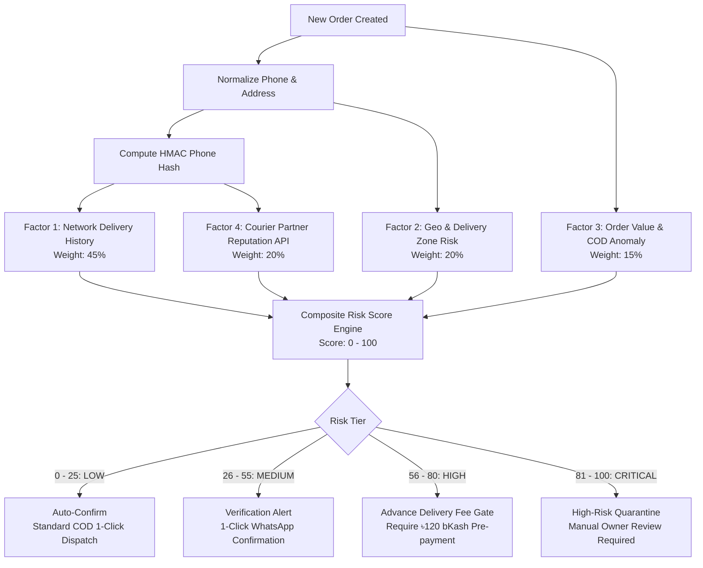
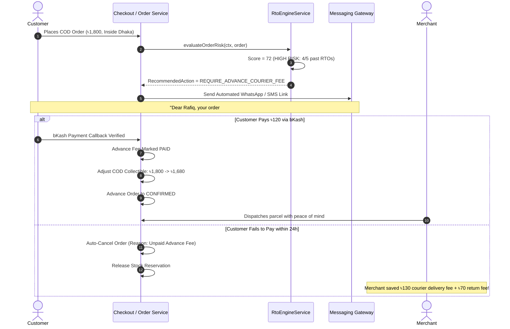
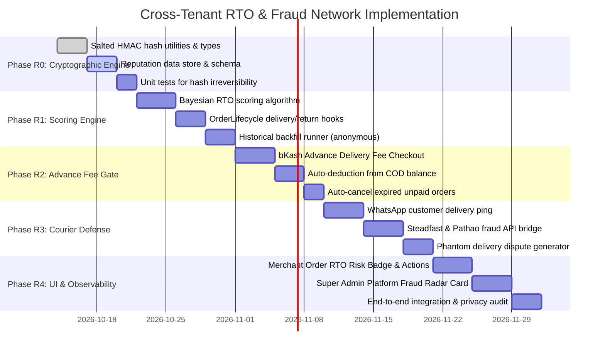

# CommerceOS — Cross-Tenant RTO & Courier Fraud Prevention Network
## Comprehensive Architectural Specification & Implementation Plan

> **Document Type:** Production Engineering Blueprint & Implementation Plan  
> **Target Systems:** Commerce Engine, Order Lifecycle, Shipping & Courier Integration, Platform Control Plane  
> **Status:** Planned Architectural Enhancement (Ready for Implementation)  
> **Governing Standards:** [GOVERNANCE.md](file:///g:/OLama/CommerceOS/.agent/GOVERNANCE.md), [tenant-isolation.md](file:///g:/OLama/CommerceOS/.agent/rules/tenant-isolation.md), [security.md](file:///g:/OLama/CommerceOS/.agent/rules/security.md)  

---

## 1. Executive Summary & Problem Definition

### 1.1 The Bangladeshi COD Crisis
In Bangladesh's e-commerce market:
- **Cash on Delivery (COD)** accounts for **70% to 85%** of all order volume.
- **Return to Origin (RTO)** rates across fashion, electronics, and lifestyle range between **18% and 32%**.
- When an order is rejected at the doorstep or fails delivery, the merchant absorbs:
  1. **Outbound Courier Fee:** ৳60 to ৳130 (Dhaka Metro vs. Outside Dhaka).
  2. **Return Delivery Surcharge:** ৳35 to ৳100 (most couriers charge 50%–100% of the delivery fee for returns).
  3. **Packaging, Bagging & Bubble Wrap:** ৳20 to ৳50 lost per parcel.
  4. **Inventory Lockup & Damage:** Seasonal fashion or perishable goods held in courier transit for 7–14 days often return unsellable.

**The Economic Impact:**  
For a store processing 1,200 monthly orders with a 25% RTO rate (300 returned parcels), the merchant loses **৳45,000 to ৳75,000 every single month** in pure non-recoverable delivery charges.

### 1.2 The Root Causes
1. **Serial Impulse Rejectors:** Buyers order the same or similar items from 3 different Facebook/WhatsApp shops and accept only whichever parcel arrives first, refusing the other two.
2. **Fake / Malicious Orders:** Competitors or pranksters placing orders with fake numbers or incomplete village addresses.
3. **Courier Rider Phantom Attempts:** Couriers (Steadfast, Pathao, RedX) frequently have riders who fail to visit the customer and falsely flag parcels as *"Customer phone switched off"* or *"Customer refused to receive"*.
4. **Information Silos:** Every merchant suffers independently. A serial canceler who refused 5 parcels across other stores is treated as a trusted first-time buyer by a new store.

### 1.3 Core Objectives
This plan establishes a **Privacy-Preserving Cross-Tenant RTO & Courier Fraud Network** that:
1. **Maintains Absolute Zero-Leakage Multi-Tenant Isolation:** Leverages one-way cryptographic salted hashing so merchants never see other merchants' names, order contents, or customer PII.
2. **Provides Real-Time Pre-Dispatch Risk Scoring (0–100):** Evaluates every incoming order against platform-wide delivery reputation before the merchant packs or books the parcel.
3. **Automates the "Advance Delivery Fee Gate":** For high-risk buyers, automatically requests the delivery fee (৳100–130) via bKash/Nagad before shipping, reducing RTO loss to zero.
4. **Monitors Courier Integrity:** Detects rider fake-attempts via automated customer WhatsApp pings, enabling automated hub disputes before parcels are returned.
5. **Replaces Passive Dashboard Metrics:** Replaces the static Super Admin "Commerce Velocity" card with a live **Platform Fraud Radar & RTO Loss Prevented** command center.

---

## 2. Privacy-Preserving Cryptographic Architecture

### 2.1 The Prime Isolation Challenge
Under CommerceOS Invariants ([tenant-isolation.md](file:///g:/OLama/CommerceOS/.agent/rules/tenant-isolation.md)):
- Tenant data must remain strictly isolated across storage and memory.
- Cross-tenant queries must **NEVER** expose raw customer PII, phone numbers, addresses, or order details.

### 2.2 Blinded Identity & Salted Reputation Model

```
┌────────────────────────────────────────────────────────────────────────────────────────┐
│                        PRIVACY-PRESERVING REPUTATION ENGINE                            │
├────────────────────────────────────────────────────────────────────────────────────────┤
│ 1. Raw Phone Input: "01712-345678"                                                     │
│ 2. Canonical E.164 Normalization: "+8801712345678"                                     │
│ 3. Cryptographic HMAC Hashing:                                                         │
│    phone_hash = HMAC_SHA256(phone, PLATFORM_RTO_PEPPER_SECRET)                         │
│ 4. Platform Reputation Table: Holds ONLY the hash and anonymous delivery statistics:  │
│    • phone_hash: "9f83a4c2...7b1a" (Irreversible 64-char hex)                         │
│    • total_orders: 12                                                                  │
│    • delivered: 3                                                                      │
│    • returned_rto: 9                                                                   │
│    • risk_tier: "VERY_HIGH" (RTO Rate: 75%)                                            │
│ 5. What Tenant A sees when evaluating an order:                                        │
│    • Risk Level: HIGH (75% Return Probability)                                         │
│    • Evidence: "9 of 12 deliveries returned across network in last 90 days."          │
│    • ZERO customer names, ZERO store names, ZERO item details shared.                  │
└────────────────────────────────────────────────────────────────────────────────────────┘
```

**Cryptographic Guarantees:**
- **No Rainbow Table Attack:** The system uses a dedicated, 64-character platform-level secret pepper (`PLATFORM_RTO_PEPPER_SECRET`).
- **Irreversibility:** It is mathematically impossible for a tenant or an external attacker to reverse `phone_hash` back to a phone number.
- **Blind Aggregation:** Network statistics are updated asynchronously upon shipment delivery or return events via system-level event hooks.

---

## 3. Multi-Factor RTO Risk Scoring Algorithm



### 3.1 Scoring Formulation

The composite risk score $R \in [0, 100]$ is computed as:

$$R = w_1 S_{\text{network}} + w_2 S_{\text{geo}} + w_3 S_{\text{order}} + w_4 S_{\text{courier}}$$

Where weights sum to $1.0$ ($w_1 = 0.45, w_2 = 0.20, w_3 = 0.15, w_4 = 0.20$):

1. **Network Delivery History ($S_{\text{network}}$):**
   - Uses empirical Bayesian smoothing to prevent unfair penalization of new buyers:
     $$S_{\text{network}} = \frac{\text{Returned Orders} + 1}{\text{Total Delivered} + \text{Returned} + 3} \times 100$$
   - *Example 1:* 1 order, 1 return $\rightarrow \frac{2}{5} \times 100 = 40$ (Cautious, not instantly 100%).
   - *Example 2:* 8 orders, 7 returns $\rightarrow \frac{8}{11} \times 100 = 73$ (Strong negative signal).
   - *Example 3:* 10 orders, 10 delivered $\rightarrow \frac{1}{13} \times 100 = 7.7$ (Highly trusted buyer).

2. **Geographical Zone Risk ($S_{\text{geo}}$):**
   - Based on division and district courier completion metrics across Bangladesh:
     - `DHAKA_METRO`: Baseline risk 12 (high courier success).
     - `CHITTAGONG_METRO`: Baseline risk 16.
     - `OUTSIDE_DHAKA_URBAN`: Baseline risk 24.
     - `REMOTE_UPAZILA / CHAR_AREAS`: Baseline risk 45 (infrequent delivery cycles, higher refusal rate).

3. **Order Value & Item Profile Anomaly ($S_{\text{order}}$):**
   - Compares order subtotal against tenant's Average Order Value (AOV):
     - Order $> 3\times$ AOV on COD: $+20$ risk.
     - Cart contains $> 3$ identical items on COD: $+15$ risk.

4. **Courier External Database Telemetry ($S_{\text{courier}}$):**
   - Connects to Steadfast/Pathao merchant fraud intelligence feeds:
     - Steadfast provides external successful delivery ratios for registered numbers.
     - If external courier API reports success rate $< 50\%$, adds $+30$ risk.

---

## 4. Data Models & TypeScript Interfaces

Stored in `src/types/rto.ts` and managed via PostgreSQL store collections (`commerceos.documents`):

### 4.1 Global Network Delivery Reputation (`network_delivery_reputations`)
```typescript
export type RtoRiskTier = "VERY_LOW" | "LOW" | "MEDIUM" | "HIGH" | "VERY_HIGH";

export interface NetworkDeliveryReputationRecord {
  /** HMAC-SHA256 hash of normalized phone number using platform pepper */
  phone_hash: string;
  total_orders_tracked: number;
  successful_deliveries: number;
  returned_rto_count: number;
  cancelled_before_ship_count: number;
  disputed_courier_attempts: number;
  
  /** Calculated rates (0 to 100) */
  delivery_success_rate: number;
  rto_rate: number;
  composite_risk_score: number; // 0 (pristine) to 100 (extreme fraud)
  risk_tier: RtoRiskTier;
  
  first_seen_at: string;
  last_outcome: "DELIVERED" | "RETURNED" | "CANCELLED" | "PENDING";
  last_outcome_at: string;
  updated_at: string;
}
```

### 4.2 Tenant-Scoped Order Evaluation (`order_rto_evaluations`)
```typescript
export type RecommendedAction = 
  | "AUTO_CONFIRM"              // Pristine buyer, ship immediately
  | "STANDARD_CONFIRM"          // Standard order, normal verification
  | "WHATSAPP_CONFIRMATION"     // Send 1-click confirmation message
  | "REQUIRE_ADVANCE_COURIER_FEE" // Collect ৳120 via bKash before shipping
  | "MANUAL_CALL_REQUIRED"      // Call customer to verify address details
  | "BLOCK_COD";                // Advance full payment only

export interface OrderRtoEvaluationRecord {
  id: string; // "rto_eval_xyz"
  tenant_id: string;
  order_id: string;
  order_number: string;
  phone_hash: string;
  
  risk_score: number; // 0 - 100
  risk_tier: RtoRiskTier;
  recommended_action: RecommendedAction;
  
  factors: {
    network_orders_count: number;
    network_success_rate: number;
    geo_risk_score: number;
    order_anomaly_score: number;
    courier_feed_score?: number;
    summary_reason: string;
  };
  
  advance_fee_requested: boolean;
  advance_fee_paid: boolean;
  advance_payment_id?: string;
  
  evaluated_at: string;
}
```

### 4.3 Tenant RTO Defense Configuration (`tenant_rto_settings`)
```typescript
export interface TenantRtoSettingsRecord {
  tenant_id: string;
  is_enabled: boolean;
  auto_advance_fee_threshold: number; // e.g. 65 (Trigger advance fee if risk >= 65)
  advance_fee_amount_bdt: number;     // e.g. 120 BDT
  auto_cancel_unpaid_hours: number;   // e.g. 24 hours
  enable_courier_fake_attempt_check: boolean;
  exempt_returning_customers: boolean; // Exempt buyers with prior successful delivery with this store
  updated_at: string;
}
```

---

## 5. Automated Merchant Protection Workflows

### 5.1 Workflow 1: The "Advance Delivery Charge Gate"



### 5.2 Workflow 2: Courier Fake-Attempt Defense Engine
Couriers in Bangladesh often flag parcels as *"Customer Refused"* without the rider ever calling or visiting the customer.

1. **Trigger:** `ShippingService.updateDeliveryStatus` receives a courier status of `FAILED` or `RETURNED`.
2. **Automated Customer Ping:**
   CommerceOS immediately dispatches an automated WhatsApp / SMS verification query:
   > *"Hello [Customer], Steadfast reported they could not deliver your parcel [TRK#]. Did the delivery rider contact you today? Reply 1 for YES, 2 for NO."*
3. **Automated Dispute Escalation:**
   - If the customer replies **NO**:
     - CommerceOS automatically flags the order with **COURIER_PHANTOM_ATTEMPT_DETECTED**.
     - Generates an automated formal dispute claim payload sent to Steadfast / Pathao Hub Manager API:
       `"Customer confirms no call or visit was made. Re-attempt delivery requested before parcel return."`
     - Saves the merchant from paying the return fee and revives the sale.

---

## 6. Super Admin & Merchant User Interfaces

### 6.1 Merchant Order View (`src/app/(dashboard)/orders/[id]/page.tsx`)
Replaces guesswork with a high-fidelity **RTO Intelligence Card**:
- **Shield Badge:** `🛡️ Risk: High (Score: 72/100)`
- **Insights:**
  - ⚠️ *"Buyer has returned 4 of their last 5 parcels across network stores."*
  - 📍 *Delivery Zone: Outside Dhaka (High courier transit return rate).*
- **Action Buttons:**
  - `[Request ৳120 Advance via bKash]` (Generates instant payment link)
  - `[Send WhatsApp Confirmation]`
  - `[1-Click Cancel Fake Order]`

### 6.2 Super Admin: Platform Fraud Radar (`src/app/super-admin/page.tsx`)
Replaces the static "Commerce Velocity" card with an authoritative telemetry component:
- **Hero KPI:** `৳1,842,500 Estimated RTO Loss Prevented` (Total courier fees saved by advance-fee gating and fake-order cancellations).
- **Network Velocity:** `18,450 Orders Screened` • `91.4% Delivery Success on Screened Orders`.
- **Active Fraud Profiles:** `4,210 High-Risk Numbers Tracked`.
- **Top RTO Hotspot Map:** Visual breakdown of return rates by Bangladesh district (Dhaka, Chittagong, Sylhet, Bogra).

---

## 7. API Surface Specification

### 7.1 Tenant APIs (`src/app/api/v1/rto/*`)

Enforces `extractRequestContext` and tenant RBAC.

| Route | Method | Purpose | Input / Output Schema |
|---|---|---|---|
| `/api/v1/rto/evaluate/[orderId]` | `GET` | Get RTO risk evaluation and recommended action for an order | Returns `OrderRtoEvaluationRecord` |
| `/api/v1/rto/advance-fee/request` | `POST` | Generate and dispatch bKash advance delivery fee link | `Body: { order_id: string, amount_bdt: number, channel: "SMS" \| "WHATSAPP" }` |
| `/api/v1/rto/settings` | `GET` | Get tenant RTO defense configuration | Returns `TenantRtoSettingsRecord` |
| `/api/v1/rto/settings` | `PATCH` | Update RTO thresholds and auto-gate rules | `Body: Partial<TenantRtoSettingsRecord>` |

### 7.2 Platform Super-Admin APIs (`src/app/api/v1/platform/rto/*`)

Enforces `extractPlatformContext` and `PlatformAuthorizationService.assertCan(ctx, "analytics.read")`.

| Route | Method | Purpose | Input / Output Schema |
|---|---|---|---|
| `/api/v1/platform/rto/radar` | `GET` | Aggregate cross-tenant RTO loss prevented, risk distribution, and hot zones | Returns `{ loss_prevented_bdt, screened_orders, network_rto_rate, district_heatmap }` |
| `/api/v1/platform/rto/reputation/[phoneHash]` | `GET` | Inspect anonymized reputation metadata for audit | Returns `NetworkDeliveryReputationRecord` |
| `/api/v1/platform/rto/disputes` | `GET` | List active courier phantom-attempt dispute cases | Returns `{ disputes: CourierDisputeRecord[], total: number }` |

---

## 8. Phased Implementation Roadmap



### Phase Details

#### Phase R0: Cryptographic Foundation & Store Collections (Days 1–5)
- **Files to create/modify:**
  - `src/types/rto.ts`: Declare all reputation, evaluation, and dispute interfaces.
  - `src/lib/rto-crypto.ts`: Implement `hashPhoneForReputation(phone: string)` with canonical E.164 normalization and HMAC-SHA256 platform pepper.
  - `src/infrastructure/db/index.ts`: Add collection methods for `network_delivery_reputations` and `order_rto_evaluations`.
- **Verification:** Unit tests verifying that phone numbers with varied formatting (`017...`, `+88017...`, `88017...`) produce the exact same hash, and that hashes cannot be mapped back to plaintext.

#### Phase R1: Bayesian Scoring & Event Hooks (Days 6–12)
- **Files to create/modify:**
  - `src/domains/rto/rto-scoring.service.ts`: Implement the 4-factor Bayesian composite scoring algorithm.
  - `src/domains/orders/order-lifecycle.service.ts`: On `advance` to `DELIVERED`, increment successful delivery count on the phone hash; on `advance` to `RETURNED`, increment RTO count.
  - `src/domains/orders/order.service.ts`: Run risk evaluation synchronously upon order creation.
- **Verification:** Test order state machine transitions updating the anonymous reputation score without any tenant data cross-contamination.

#### Phase R2: Advance Delivery Fee Gate (Days 13–19)
- **Files to create/modify:**
  - `src/domains/rto/advance-fee.service.ts`: Generate tokenized bKash payment links for advance delivery fees.
  - `src/domains/payments/payment.service.ts`: Handle advance fee callback, decrement COD collectible amount, and mark order as `CONFIRMED`.
- **Verification:** Verify that paying a ৳120 delivery fee on an ৳1,800 COD order properly adjusts the final courier collectible invoice to ৳1,680.

#### Phase R3: Courier Phantom-Attempt Defense (Days 20–27)
- **Files to create/modify:**
  - `src/domains/shipping/courier-dispute.service.ts`: Listen for courier `FAILED`/`RETURNED` webhook events, send WhatsApp survey ping, and create courier dispute logs.
- **Verification:** Mock courier `FAILED` webhook, simulate customer answering "Rider did not call", and confirm dispute record generation.

#### Phase R4: User Experience & Control Plane (Days 28–35)
- **Files to create/modify:**
  - `src/app/(dashboard)/orders/[id]/page.tsx`: Embed RTO Risk Badge, return probability bar, and action buttons.
  - `src/app/super-admin/page.tsx`: Replace static "Commerce Velocity" card with the real-time **Platform Fraud Radar & RTO Loss Prevented** telemetry component.
- **Verification:** UI visual inspection in browser across mobile and desktop.

---

## 9. Security, Governance & Tenancy Invariants

In strict adherence to [GOVERNANCE.md](file:///g:/OLama/CommerceOS/.agent/GOVERNANCE.md) and [tenant-isolation.md](file:///g:/OLama/CommerceOS/.agent/rules/tenant-isolation.md):
1. **Absolute Identity Blinding:** The `network_delivery_reputations` table contains **ZERO** personal data—no names, emails, delivery addresses, order numbers, or merchant IDs. It stores only cryptographic hashes and numerical counters.
2. **Context Resolution:** Every evaluation query verifies the tenant session token via `extractRequestContext`. Merchants can only evaluate orders belonging to their own workspace.
3. **Audit Trail:** Every advance fee request, manual risk override, and courier dispute is recorded in the immutable audit log with actor ID and timestamp.
4. **Honest Reporting (No Synthetic Data):** If an order has a newly registered phone number with zero network history, the system honestly reports `NO_HISTORY_UNVERIFIED` with neutral Bayesian risk. It never invents fake scores or random metrics.

---

## 10. Verification & Acceptance Criteria

| Check | Target / Acceptance Criteria | Verification Method |
|---|---|---|
| **Zero PII Leakage** | No query or response contains cross-tenant store names, buyer names, or addresses. | Privacy regression test in `tests/rto-privacy-tests.ts`. |
| **Phone Hash Determinism** | `01712-345678` and `+8801712345678` produce identical HMAC hashes. | Unit tests in `tests/rto-crypto-tests.ts`. |
| **Bayesian Smoothing** | First-time buyers with 1 cancellation are not unfairly branded with 100% risk. | Algorithmic test suite. |
| **Atomic COD Adjustment** | Paying advance fee updates order financial total and COD amount without discrepancy. | Order lifecycle integration tests. |
| **Postgres Persistence** | Reputation and evaluation records persist and reload cleanly in PGlite. | `npm run test:pg`. |
| **Zero Type Errors** | Clean TypeScript build with zero warnings. | `npm run type-check`. |
