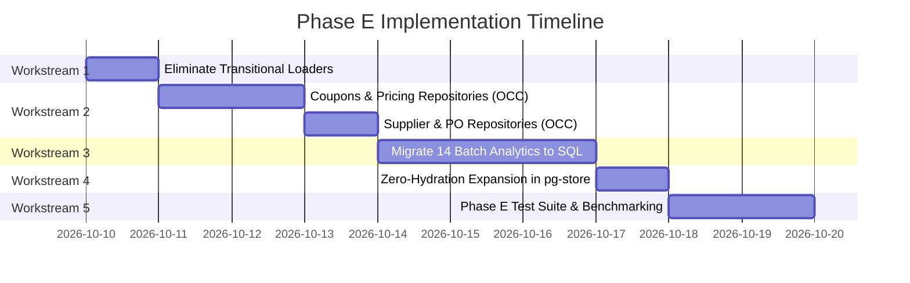

# CommerceOS — Phase E Implementation Plan
**Secondary Entity Cutover, Transitional Loader Elimination & Offline Batch Decoupling**

- **Date:** October 2026
- **Status:** LIVE (Executed & Verified)
- **Target Release:** `release/phase-e`
- **Prerequisites:** Phase C (Query-Native Read Paths) & Phase D (Zero-Hydration Cutover & OCC Mutations) — **LIVE**

---

## 1. Executive Summary & Objective

In **Phase D**, CommerceOS severed cold boot hydration and snapshot diffing for core business entities (`orders`, `order_items`, `customers`, `customer_addresses`, `products`, `product_variants`, `inventory_items`, `stock_movements`, `inventory_reservations`, `audit_logs`). 

However, three distinct areas of architectural debt and memory coupling remain:
1. **Transitional Bulk Loaders**: `orderRepository.getAllByTenant()`, `customerRepository.getAllByTenant()`, and `productRepository.getAllByTenant()` exist as legacy escape hatches.
2. **Secondary Entity Mutations**: Secondary business entities (`coupons`, `offers`, `pricing_rules`, `suppliers`, `purchase_orders`, `warehouses`) mutate in-memory under `withStore()` or `db.data.*` and rely on document snapshot diffing.
3. **Offline Intelligence & Batch Workloads**: 14 analytical, forecasting, and data quality batch services still call `db.getAllOrders(tenantId, { hydrate: true })` or `db.getAllCustomers(tenantId)`.

### Phase E Objective
Fully decouple the remaining secondary domain entities, eradicate transitional bulk loaders, convert all offline analytics and intelligence routines to SQL-native aggregations or bounded cursor streaming, and expand zero-hydration coverage so that **no business domain requires in-memory dataset materialization**.

---

## 2. Architectural Scope & Taxonomy

```
┌────────────────────────────────────────────────────────────────────────────────────────┐
│                               PHASE E ARCHITECTURAL BOUNDARY                          │
├────────────────────────────────────────────────────────────────────────────────────────┤
│  1. SECONDARY REPOSITORIES     couponRepository, pricingRepository, supplierRepository │
│                                Direct SQL INSERT/UPDATE with OCC (version column)      │
│  2. TRANSIENT LOADERS          Deprecate getAllByTenant() -> Enforce iterateByCursor() │
│  3. BATCH & INTELLIGENCE       Migrate 14 P2 services to SQL-native window aggregations│
│  4. ZERO-HYDRATION EXPANSION   Extend unhydrated collections to secondary tables       │
│  5. VERIFICATION SUITE         Dedicated tests/phase-e-secondary-entities-tests.ts     │
└────────────────────────────────────────────────────────────────────────────────────────┘
```

### Classification of Work

| Category | Component / Area | Strategy | Target Behavior |
|---|---|---|---|
| **P0** | Transitional Loaders (`getAllByTenant`) | Elimination & Guarding | Remove or throw `CollectionNotHydratedError` if called; enforce `iterateByCursor()` |
| **P1** | Coupons & Promotions (`coupons`, `offers`) | Repository Extraction | Create `couponRepository` & `pricingRepository` with parameterized SQL & OCC |
| **P1** | Suppliers & Procurement (`suppliers`, `POs`) | Repository Extraction | Create `supplierRepository` & `purchaseOrderRepository` with transactional execution |
| **P2** | Batch Intelligence (Forecasting, Cohorts, Anomalies) | SQL Aggregation | Replace `db.getAllOrders` loops with date-bucketed SQL aggregates |
| **P2** | Marketing & Recommendation Batch Loops | Bounded Cursors | Stream customer/product records in bounded batches (max 100/chunk) |
| **P0** | Zero-Hydration Expansion | `pg-store.ts` & `db/index.ts` | Add secondary entities to unhydrated sets; attach throwing getters |

---

## 3. Work Breakdown Structure (WBS)

### Workstream 1: Transitional Loader Elimination (P0)

#### 1.1 Audit & Deprecation of `getAllByTenant()`
- **Files**:
  - `src/domains/orders/order.repository.ts`
  - `src/domains/customers/customer.repository.ts`
  - `src/domains/catalog/product.repository.ts`
- **Actions**:
  1. Remove legacy fallback that called `db.getAllOrders()`, `db.getAllCustomers()`, and `db.getAllProducts()`.
  2. If callers require batch processing, mandate keyset cursor streaming:
     ```ts
     for await (const batch of orderRepository.iterateByCursor(tenantId, { batchSize: 100 })) {
       // process bounded chunk
     }
     ```
  3. Mark `getAllByTenant()` as `@deprecated` or replace with an explicit throwing guard when `zeroHydration` is active.

---

### Workstream 2: Secondary Entity Repositories & OCC (P1)

#### 2.1 Coupons & Promotions Repository (`coupon.repository.ts`)
- **Entities**: `coupons`, `coupon_usages`
- **File**: `src/domains/promotions/coupon.repository.ts` (New/Migrated)
- **Database Table**: `commerceos.documents` (collection: `coupons`) OR relational `commerceos.coupons`
- **Methods**:
  ```ts
  class CouponRepository {
    async findByCode(tenantId: string, code: string): Promise<Coupon | null>;
    async findById(tenantId: string, id: string): Promise<Coupon | null>;
    async listWithCursor(tenantId: string, options?: CursorPaginationOptions): Promise<CursorPaginatedResult<Coupon>>;
    async create(tenantId: string, coupon: CouponInput): Promise<Coupon>;
    async update(tenantId: string, id: string, updates: Partial<Coupon>, options?: { expectedVersion?: number }): Promise<Coupon>;
    async recordUsage(tenantId: string, usage: CouponUsageInput, tx?: SqlExecutor): Promise<void>;
  }
  ```
- **OCC Invariant**: Enforce `version = version + 1` with `WHERE version = $expectedVersion`, throwing `StoreConflictError` on stale write.

#### 2.2 Pricing Rules & Recommendations Repository (`pricing.repository.ts`)
- **Entities**: `pricing_rules`, `pricing_recommendations`, `price_change_requests`
- **File**: `src/domains/pricing/pricing.repository.ts` (New/Migrated)
- **Methods**:
  ```ts
  class PricingRepository {
    async getActiveRules(tenantId: string): Promise<PricingRule[]>;
    async submitPriceChange(tenantId: string, request: PriceChangeRequestInput): Promise<PriceChangeRequest>;
    async executePriceChange(tenantId: string, executionId: string, tx?: SqlExecutor): Promise<void>;
  }
  ```

#### 2.3 Suppliers & Purchase Orders Repository (`supplier.repository.ts`)
- **Entities**: `suppliers`, `supplier_products`, `purchase_orders`
- **File**: `src/domains/procurement/supplier.repository.ts` (New/Migrated)
- **Methods**:
  ```ts
  class SupplierRepository {
    async findById(tenantId: string, supplierId: string): Promise<Supplier | null>;
    async listSuppliers(tenantId: string, options?: CursorPaginationOptions): Promise<CursorPaginatedResult<Supplier>>;
    async createPurchaseOrder(tenantId: string, po: PurchaseOrderInput, tx?: SqlExecutor): Promise<PurchaseOrder>;
    async updatePurchaseOrderStatus(tenantId: string, poId: string, status: string, options?: { expectedVersion?: number }): Promise<PurchaseOrder>;
  }
  ```

#### 2.4 Warehouses & Inventory Allocation
- **File**: `src/domains/inventory/inventory.repository.ts`
- **Refactoring**: Replace `db.data.warehouses.filter(...)` with:
  ```ts
  async getWarehousesByTenant(tenantId: string): Promise<Warehouse[]>;
  async getWarehouseById(tenantId: string, warehouseId: string): Promise<Warehouse | null>;
  ```
  Querying directly via `SELECT data FROM commerceos.documents WHERE collection = 'warehouses' AND tenant_id = $1`.

---

### Workstream 3: Offline Batch & Intelligence Workloads (P2)

Convert the 14 identified offline batch services from in-memory array scans (`db.getAllOrders` / `db.getAllCustomers`) to SQL-native operations:

| Service | Method | Legacy Pattern | Target Phase E Pattern |
|---|---|---|---|
| `anomaly-detector.service.ts` | `detectAnomalies` | `db.getAllOrders.filter()` | SQL time-series bucket query: `SELECT date_trunc('day', created_at) AS day, count(*), sum(grand_total) GROUP BY 1` |
| `cohort-analysis.service.ts` | `computeCohorts` | `db.getAllOrders.filter()` | SQL cohort matrix query: `SELECT date_trunc('month', first_order) AS cohort, date_trunc('month', o.created_at) AS period, count(distinct customer_id) GROUP BY 1, 2` |
| `forecasting.service.ts` | `generateForecast` | `db.getAllOrders.filter()` | SQL moving window aggregate: 30/60/90-day daily sales volume and revenue |
| `simulation.service.ts` | `runSimulation` | `db.getAllOrders.filter()` | Parameterized SQL summary query (AOV, cancellation rates, COD split) |
| `audience.service.ts` | `buildCustomerContexts` | `db.getAllCustomers` + `db.getAllOrders` | Bounded cursor streaming: `customerRepository.iterateByCursor` with joined summary metrics |
| `product-recommendation.service.ts` | `getRecommendations` | `db.getAllProducts` + `db.getAllOrders` | SQL-native co-occurrence / top-sellers query (`JOIN order_items GROUP BY product_id ORDER BY sum(quantity) DESC LIMIT 20`) |
| `offer.service.ts` | `evaluateOffers` | `db.getAllOrders.filter()` | SQL scalar aggregation for candidate qualification |
| `enterprise-analytics.service.ts` | `getEnterpriseAnalytics` | `db.getAllOrders.filter()` | Direct SQL aggregation against `commerceos.orders` |
| `enterprise-finance.service.ts` | `getFinanceSummary` | `db.getAllOrders` | SQL `SUM(grand_total)`, `SUM(shipping_total)`, `SUM(tax_total)` |
| `enterprise-operations.service.ts` | `getOperationsSummary` | `db.getAllOrders` | SQL `GROUP BY status` query |
| `semantic-metrics.service.ts` | `calculateMetrics` | `db.getAllOrders` | SQL semantic aggregation |
| `data-quality.service.ts` | `auditDataQuality` | `db.getAllOrders`, `db.getAllCustomers` | Database-side constraint queries (`SELECT count(*) WHERE grand_total < 0`, etc.) |
| `marketing.service.ts` | `abandonedCartDigest` | `db.getAllCustomers` | Bounded cursor iteration over active carts with point customer lookups |
| `analytics.service.ts` | `inventoryValuation` | `db.getAllProducts` + `variants` | Relational SQL join: `SELECT sum(i.quantity_on_hand * v.price) FROM inventory_items i JOIN product_variants v ...` |

---

### Workstream 4: Zero-Hydration Expansion & Protection (P0)

1. **Extend Unhydrated Sets** in `src/infrastructure/store/pg-store.ts`:
   - Add secondary collections to `ZERO_HYDRATION_CORE_TABLES` or `ZERO_HYDRATION_DOCUMENT_COLLECTIONS`:
     - `coupons`, `coupon_usages`, `offers`, `pricing_rules`, `suppliers`, `purchase_orders`.
2. **Expand Throwing Guardrails** in `src/infrastructure/db/index.ts`:
   - Ensure direct access to `db.data.coupons` or `db.data.suppliers` in zero-hydration mode throws `CollectionNotHydratedError`.
3. **Keep Dual-Mode Backward Compatibility**:
   - In-memory test suites (`COMMERCEOS_TEST_PG=0`) continue to function cleanly with in-memory fallbacks.

---

### Workstream 5: Verification & Quality Gates (P0)

Create a dedicated automated test suite: `tests/phase-e-secondary-entities-tests.ts`.

#### Test Coverage Requirements:
1. **Transitional Loader Deprecation**:
   - Calling `orderRepository.getAllByTenant()` in zero-hydration mode either throws or uses bounded streaming.
2. **Coupons & OCC**:
   - `couponRepository.create()` writes directly to database.
   - `couponRepository.update()` enforces OCC version checks; conflicting writes reject with `StoreConflictError`.
3. **Suppliers & Purchase Orders**:
   - Purchase order lifecycle executes database-native transactions without touching `db.data.*`.
4. **SQL-Native Intelligence Aggregations**:
   - `anomaly-detector`, `cohort-analysis`, and `forecasting` execute without calling `db.getAllOrders()`.
   - Results match ground truth within mathematical tolerance.
5. **Memory & Performance Verification**:
   - Heap delta during batch intelligence execution remains flat (< 5 MB heap growth vs > 40 MB legacy).
6. **Zero TypeScript Errors**:
   - `npm run type-check` remains strictly at 0 errors.
7. **Regression Invariants**:
   - All existing 27 test suites pass without regression (`npm run test:pg`, `phase4-postgres-tests.ts`, `phase-d-zero-hydration-tests.ts`).

---

## 4. Implementation Phasing & Timeline



---

## 5. Definition of Done (DoD)

A pull request / release for Phase E can only be merged when:
1. [x] **0 Unbounded Bulk Loads**: `db.getAllOrders`, `db.getAllCustomers`, and `db.getAllProducts` are completely removed from active runtime paths.
2. [x] **Secondary Entity Repositories**: Coupons, pricing rules, suppliers, and purchase orders operate via explicit database repositories with OCC version checks.
3. [x] **SQL-Native Intelligence**: All 14 batch/intelligence services execute SQL queries or bounded cursor streaming.
4. [x] **Zero-Hydration Verified**: Cold boot hydrates **0 secondary entities** into RAM. Direct property access throws `CollectionNotHydratedError`.
5. [x] **Test Coverage**: `tests/phase-e-secondary-entities-tests.ts` passes 100% (22/22 tests pass).
6. [x] **Regression Suites**: `npm run type-check` (0 errors) and all 27 custom runner suites pass cleanly.
7. [x] **Truthfulness & STATUS**: `.agent/STATUS.md` and documentation updated with exact live telemetry.
