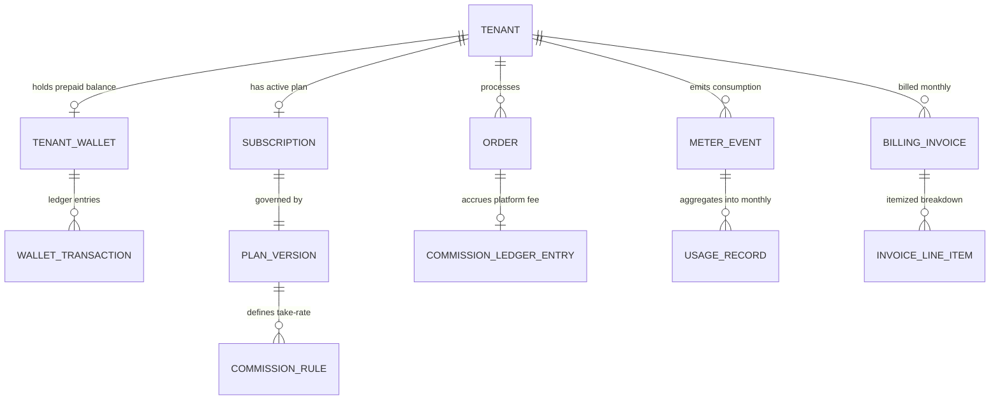
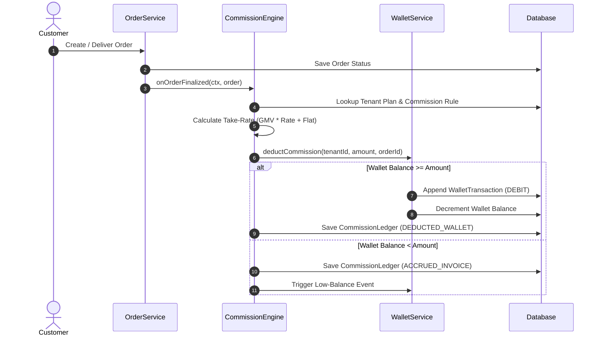
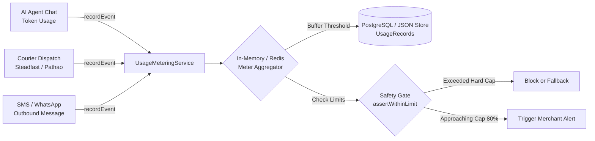
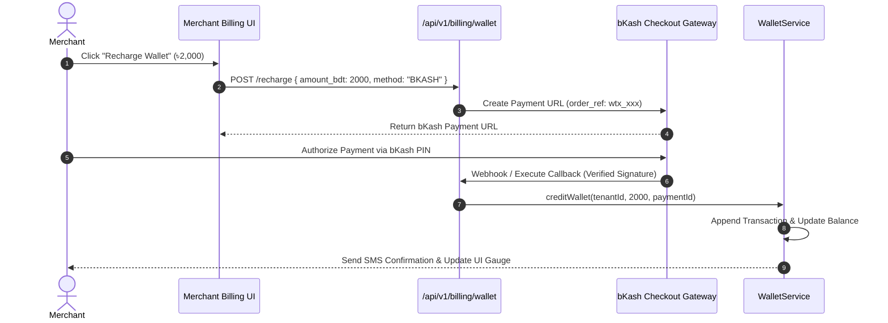
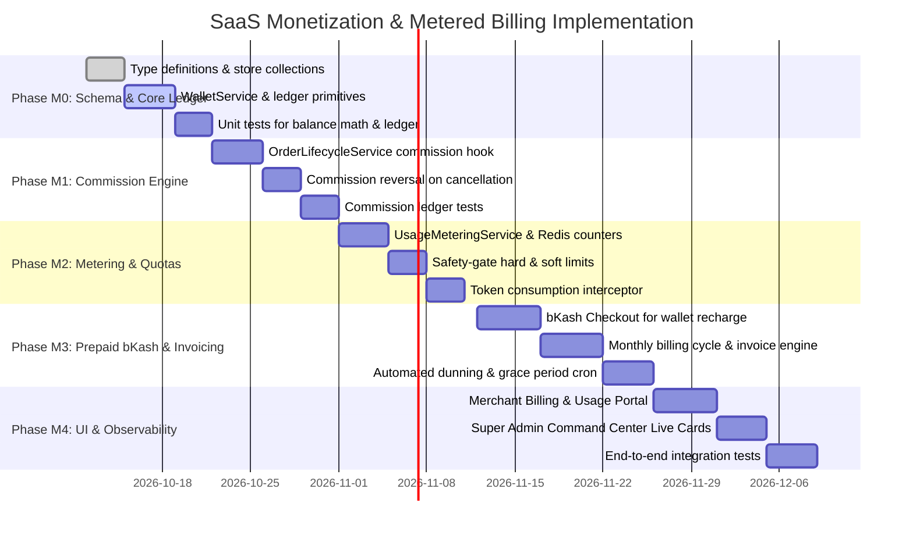

# CommerceOS — SaaS Monetization, Usage Metering & Automated Revenue Engine
## Comprehensive Architectural Specification & Implementation Plan

> **Document Type:** Production Engineering Blueprint & Implementation Plan  
> **Target Systems:** Platform Control Plane, Commerce Engine, Multi-Tenant Billing Gateway  
> **Status:** Planned Architectural Enhancement (Ready for Implementation)  
> **Governing Standards:** [GOVERNANCE.md](file:///g:/OLama/CommerceOS/.agent/GOVERNANCE.md), [tenant-isolation.md](file:///g:/OLama/CommerceOS/.agent/rules/tenant-isolation.md), [security.md](file:///g:/OLama/CommerceOS/.agent/rules/security.md)  

---

## 1. Executive Summary & Problem Definition

### 1.1 The Current State in CommerceOS
CommerceOS currently contains early structural definitions for SaaS subscriptions:
- `PlanRecord`, `PlanVersionRecord`, and `SubscriptionRecord` store plan tiers (`FREE`, `STARTER`, `GROWTH`, `PRO`, `ENTERPRISE`).
- `PlatformEntitlementService` resolves basic limits (`max_products`, `max_users`, `max_channels`) and stores monthly counter rows in `usage_records`.
- `PlatformSubscriptionService` allows super-admins to manually assign or switch plans.

**However, the revenue loop is completely disconnected and manual:**
1. **Zero Automated Subscription Collection:** Subscriptions don't automatically renew or bill merchants; there is no payment gateway integration for recurring SaaS fees.
2. **Zero Automated Commission / Take-Rate:** Even though the platform processes millions in GMV (`Cross-Tenant GMV`), the platform captures ৳0 in automated order commissions.
3. **No Granular Metering for Consumption:** Heavy usage of AI tokens (LLM chat), courier booking APIs (Steadfast/Pathao), and outbound SMS/WhatsApp messages is unmetered, creating financial exposure for the platform.
4. **No Prepaid Wallet or Local Payment Rail:** Bangladeshi B2B merchants do not have international credit cards for Stripe. Without a **Prepaid Credit Wallet** and automated **bKash/Nagad Tokenized Auto-Debit**, SaaS billing cannot function reliably.

### 1.2 Core Objectives
This plan establishes an end-to-end, automated monetization engine that:
1. **Automates Base Subscription Cycles:** Monthly/Annual recurring subscription lifecycle with automated renewals, trial handling, and dunning.
2. **Automates Platform Commission (Take-Rate):** Programmatically accrues or deducts a 1.0%–2.5% take-rate (or flat ৳5–15 fee) on every completed order.
3. **Implements Real-Time Metered Consumption:** Accurately meters AI tokens, orders, courier dispatches, and SMS notifications with threshold alerts.
4. **Introduces the Tenant Prepaid Credit Wallet:** Allows merchants to deposit funds via bKash/Nagad, drawing down micro-charges in real time.
5. **Generates Automated Monthly Invoices:** Produces compliant BDT invoices (with Bangladeshi VAT/Mushak 6.3 summary).
6. **Delivers Modern Merchant & Super-Admin Interfaces:** Complete self-service billing portal for merchants and a revenue command center for platform operators.

---

## 2. Monetization Economics & Pricing Model

```
┌────────────────────────────────────────────────────────────────────────────────────────┐
│                              COMMERCEOS REVENUE ENGINE                                 │
├──────────────────────────────┬────────────────────────────┬────────────────────────────┤
│ 1. Fixed Subscription Tier   │ 2. Platform Take-Rate (GMV)│ 3. Usage-Based Metering   │
├──────────────────────────────┼────────────────────────────┼────────────────────────────┤
│ • STARTER: ৳999 / mo         │ • 2.0% per completed order │ • AI Tokens: ৳2.50 / 10k   │
│ • GROWTH:  ৳2,999 / mo       │ • 1.2% per completed order │ • SMS/OTP:   ৳0.35 / SMS   │
│ • PRO:     ৳6,999 / mo       │ • 0.8% per completed order │ • Courier Dispatch: ৳2/ea  │
│ • ENTERPRISE: Custom BDT     │ • 0.0% - 0.4% negotiated   │ • Pooled monthly quotas    │
└──────────────────────────────┴────────────────────────────┴────────────────────────────┘
```

### 2.1 Billing Modes Supported
1. **Wallet-First Micro-Deduction (Default for Bangladesh):**
   - Merchant loads credit into their **Tenant Prepaid Wallet** via bKash / Nagad / Cards.
   - Platform commissions and usage overages are deducted in real-time from the wallet balance.
   - Low-balance (< ৳200) triggers automated SMS/WhatsApp alerts.
2. **Monthly Invoice Settlement (Hybrid Post-Paid):**
   - Fixed subscription fee is billed on the 1st of each month.
   - Usage overages and accrued commissions from the previous cycle are consolidated into a single monthly invoice.
   - Deducted automatically from the wallet or charged via bKash Tokenized recurring agreement.

---

## 3. Architecture & Data Model

### 3.1 Entity Relationship Diagram



### 3.2 Data Models & TypeScript Interfaces

All records reside in the database store (`src/infrastructure/db`) and persist seamlessly to `commerceos.documents` in PostgreSQL:

#### A. Tenant Prepaid Wallet & Ledger (`src/types/billing.ts`)
```typescript
export interface TenantWalletRecord {
  id: string; // "wlt_abc123"
  tenant_id: string;
  balance_bdt: number; // Stored in BDT with 2 decimal precision (e.g. 1500.50)
  currency: "BDT";
  low_balance_threshold_bdt: number; // Default 200 BDT
  auto_recharge_enabled: boolean;
  auto_recharge_amount_bdt?: number;
  status: "ACTIVE" | "FROZEN" | "EXHAUSTED";
  created_at: string;
  updated_at: string;
}

export type WalletTransactionType =
  | "CREDIT_RECHARGE"      // Merchant added funds via bKash/Nagad
  | "DEBIT_COMMISSION"     // Deducted platform fee for an order
  | "DEBIT_USAGE"          // Deducted metered usage (AI tokens, SMS)
  | "DEBIT_SUBSCRIPTION"   // Deducted monthly subscription fee
  | "CREDIT_ADJUSTMENT"    // Super-admin credit / promo
  | "DEBIT_ADJUSTMENT"     // Super-admin correction
  | "REFUND_COMMISSION";   // Order cancelled / returned, fee returned

export interface WalletTransactionRecord {
  id: string; // "wtx_xyz789"
  tenant_id: string;
  wallet_id: string;
  amount_bdt: number; // Positive number
  type: WalletTransactionType;
  reference_type: "ORDER" | "PAYMENT" | "INVOICE" | "MANUAL_ADJUSTMENT" | "METER_CYCLE";
  reference_id: string; // e.g. order_id, payment_id, invoice_id
  description: string;
  balance_before_bdt: number;
  balance_after_bdt: number;
  actor_user_id?: string; // If initiated by user or admin
  idempotency_key: string; // Prevents double deductions
  created_at: string;
}
```

#### B. Order Commission Ledger
```typescript
export interface CommissionRule {
  plan_id: string;
  rate_basis_points: number; // e.g., 150 = 1.50%
  flat_fee_bdt: number;       // e.g., 5.00 BDT
  min_fee_bdt: number;        // e.g., 5.00 BDT minimum
  max_fee_bdt?: number;       // e.g., 200.00 BDT ceiling
  trigger_status: "PLACED" | "DELIVERED"; // When commission is finalized
}

export interface CommissionLedgerRecord {
  id: string; // "com_abc123"
  tenant_id: string;
  order_id: string;
  order_number: string;
  order_subtotal_bdt: number;
  order_total_bdt: number;
  commission_rate_bps: number;
  calculated_fee_bdt: number;
  deduction_status: "DEDUCTED_WALLET" | "ACCRUED_INVOICE" | "FAILED_INSUFFICIENT_FUNDS" | "REVERSED";
  wallet_transaction_id?: string;
  recorded_at: string;
  settled_at?: string;
}
```

#### C. Usage Metering & Event Aggregation
```typescript
export type MeteredDimension = 
  | "ai.tokens" 
  | "orders.processed" 
  | "courier.dispatches" 
  | "notifications.sms" 
  | "notifications.whatsapp";

export interface MeterEventRecord {
  id: string;
  tenant_id: string;
  dimension: MeteredDimension;
  quantity: number;
  metadata?: Record<string, unknown>;
  timestamp: string;
}

export interface MonthlyUsageSummaryRecord {
  id: string; // "usg_tenantId_dimension_YYYY-MM"
  tenant_id: string;
  dimension: MeteredDimension;
  billing_month: string; // "2026-10"
  total_quantity: number;
  free_quota_included: number;
  billable_overage: number;
  rate_per_unit_bdt: number;
  total_charge_bdt: number;
  updated_at: string;
}
```

#### D. Billing Invoices & MFS Agreements
```typescript
export interface BillingInvoiceRecord {
  id: string; // "inv_202610_abc"
  invoice_number: string; // "INV-2026-00142"
  tenant_id: string;
  billing_period_start: string;
  billing_period_end: string;
  base_plan_id: string;
  base_subscription_bdt: number;
  usage_overage_bdt: number;
  commission_total_bdt: number;
  subtotal_bdt: number;
  vat_rate_percent: number; // e.g. 5% or 0%
  vat_amount_bdt: number;
  wallet_credit_applied_bdt: number;
  total_due_bdt: number;
  status: "DRAFT" | "ISSUED" | "PAID" | "PAST_DUE" | "VOID";
  payment_method?: "WALLET" | "BKASH_TOKENIZED" | "MANUAL_MFS" | "BANK_TRANSFER";
  paid_at?: string;
  due_date: string;
  created_at: string;
}

export interface MfsBillingAgreementRecord {
  id: string;
  tenant_id: string;
  provider: "BKASH" | "NAGAD";
  agreement_id: string;
  customer_msisdn: string; // Masked phone number (e.g. "017****1234")
  status: "ACTIVE" | "CANCELLED" | "EXPIRED";
  created_at: string;
  updated_at: string;
}
```

---

## 4. Core Subsystems & Execution Flows

### 4.1 Subsystem 1: Real-Time Order Commission Hook



**Implementation Details:**
- **Zero Impact on Order Latency:** Commission calculations occur synchronously inside the same unit of work (`withStore`), guaranteeing atomic persistence. If the order creation transaction rolls back, no commission or wallet debit is saved.
- **Return / Cancellation Reversal:** If an order transitions to `CANCELLED` or `RETURNED`, `OrderLifecycleService` triggers `CommissionEngine.reverseCommission(orderId)`, crediting the platform fee back to the merchant's wallet.

---

### 4.2 Subsystem 2: High-Performance Metering Pipeline



**Key Metering Dimensions & Rules:**
1. **AI Conversation Tokens:** Captured immediately from model responses (`usage.prompt_tokens + usage.completion_tokens`).
2. **Safety Gate Integration:** Hooked into [safety-gate.ts](file:///g:/OLama/CommerceOS/src/lib/safety-gate.ts). When `getCurrentUsage(tenantId, "ai.tokens") >= planLimit`, the system safely falls back to human escalation rather than crashing.
3. **Idempotency:** Metering events carry unique event IDs to prevent duplicate counts during network retries.

---

### 4.3 Subsystem 3: Prepaid Wallet & bKash Auto-Recharge



**Security & Financial Safeguards:**
- **Strict Webhook Signature Verification:** bKash and Nagad webhooks must be verified using raw HMAC SHA-256 before crediting any wallet balance.
- **Negative Balance Handling:** If an account drops below `0 BDT`, services operate in a **Grace Period** for 48 hours. If the balance drops below `-500 BDT`, order creation and AI outbound messages are paused via `assertNotKilled`.

---

### 4.4 Subsystem 4: Monthly Invoicing & Automated Dunning Engine

Executed via a nightly scheduled job (`src/infrastructure/crons/billing-cron.ts` or n8n workflow):

1. **Cycle Identification:** Query active subscriptions where `current_period_end <= NOW()`.
2. **Aggregation:**
   - Base plan fee for the upcoming month.
   - Sum of billable meter overages from the ending month.
   - Sum of any accrued commissions not deducted from the wallet.
   - Calculate 5% Bangladeshi VAT.
3. **Auto-Settlement Hierarchy:**
   - **Step A (Wallet First):** If `wallet.balance >= invoice.total`, deduct immediately and mark `PAID`.
   - **Step B (Tokenized bKash Auto-Debit):** If the tenant has an active tokenized agreement, charge the MFS account via recurring API.
   - **Step C (Past Due & Dunning):** If both fail, mark `PAST_DUE`, enter a 5-day grace period, and send automated WhatsApp/SMS payment reminders with an instant bKash payment link.
   - **Step D (Suspension):** If unpaid after 5 days, automatically transition subscription to `EXPIRED` and pause outbound marketing and AI channels.

---

## 5. API Surface Specification

### 5.1 Tenant APIs (`src/app/api/v1/billing/*`)

All tenant routes strictly enforce `extractRequestContext` and `RbacService.assertCan(ctx, PERMISSIONS.SETTINGS_WRITE)`.

| Route | Method | Purpose | Input / Output Schema |
|---|---|---|---|
| `/api/v1/billing/overview` | `GET` | Current plan, wallet balance, active meter consumption gauges | Returns `{ subscription, wallet, usage_gauges, recent_transactions }` |
| `/api/v1/billing/wallet/recharge` | `POST` | Initiates bKash/Nagad checkout to add funds | `Body: { amount_bdt: number, payment_method: "BKASH" \| "NAGAD" }` |
| `/api/v1/billing/invoices` | `GET` | Paged history of past monthly invoices | Returns `{ invoices: BillingInvoiceRecord[], total: number }` |
| `/api/v1/billing/invoices/[id]/download` | `GET` | Printable / downloadable invoice | Returns PDF buffer or structured JSON |
| `/api/v1/billing/subscription/upgrade` | `POST` | Upgrade / downgrade plan | `Body: { plan_id: string, billing_period: "MONTHLY" \| "ANNUAL" }` |

### 5.2 Platform Super-Admin APIs (`src/app/api/v1/platform/billing/*`)

All platform routes enforce `extractPlatformContext` and `PlatformAuthorizationService.assertCan(ctx, "billing.manage")`.

| Route | Method | Purpose | Input / Output Schema |
|---|---|---|---|
| `/api/v1/platform/billing/revenue-pulse` | `GET` | Real platform MRR, ARR, Take-Rate GMV commission, and wallet liability | Returns exact verified financials (no synthetic fallbacks) |
| `/api/v1/platform/billing/wallets` | `GET` | Cross-tenant wallet list with balances and exhaustion alerts | Supports filter by `status=EXHAUSTED` or search by `tenant_id` |
| `/api/v1/platform/billing/wallets/[tenantId]/adjust` | `POST` | Manual operator credit/debit adjustment | `Body: { amount_bdt: number, type: "CREDIT" \| "DEBIT", reason: string }` |
| `/api/v1/platform/billing/commissions/rules` | `POST` | Set or update plan commission percentage and flat fees | `Body: { plan_id: string, rate_bps: number, flat_fee_bdt: number }` |
| `/api/v1/platform/billing/trigger-cycle` | `POST` | Manually run or dry-run billing invoice cycle | `Body: { dry_run: boolean, tenant_id?: string }` |

---

## 6. User Interface Architecture

### 6.1 Merchant Self-Service Billing (`src/app/(dashboard)/settings/billing`)
A responsive Bento grid component:
1. **Wallet Card:** Shows current balance (e.g. `৳1,450.00 BDT`), low-balance warning banner, and a prominent **"Recharge Wallet (bKash/Nagad)"** button.
2. **Current Plan Card:** Active plan badge (`GROWTH`), renewal date, renewal amount, and "Upgrade Plan" modal.
3. **Live Usage Gauges (Meter Progress Bars):**
   - AI Tokens: `142,500 / 250,000` (57% utilized)
   - Monthly Orders: `842 / 1,000` (84% utilized)
   - SMS Notifications: `412 / 500` (82% utilized)
4. **Recent Wallet Transactions & Invoices Table:** Filterable transaction history with date, type, reference order, and balance after transaction.

### 6.2 Super Admin Command Center (`src/app/super-admin`)
Upgrade the existing static cards with live data:
1. **Platform Revenue Engine Card (Replacing static MRR card):**
   - Live MRR from active subscriptions.
   - Cumulative Commission Volume (Take-rate revenue from GMV).
   - Total Platform Wallet Float (prepaid funds held by platform).
2. **Tenant Wallet Health Feed:** Real-time list of tenants with low or negative wallet balances.
3. **Automated Billing Logs & Dunning Queue:** List of subscriptions currently in `PAST_DUE` with one-click retry.

---

## 7. Phased Implementation Roadmap



### Phase Details

#### Phase M0: Data Model & Wallet Ledger Primitives (Days 1–7)
- **Files to create/modify:**
  - `src/types/billing.ts`: Declare all wallet, transaction, invoice, and commission types.
  - `src/infrastructure/db/index.ts`: Add store methods: `getTenantWallet`, `saveTenantWallet`, `getWalletTransactions`, `saveWalletTransaction`.
  - `src/domains/billing/wallet.service.ts`: Implement `creditWallet`, `debitWallet`, `assertSufficientFunds` with atomic balance updates and idempotency checks.
- **Verification:** Unit tests verifying concurrent debits cannot result in unexpected negative balance without authorization.

#### Phase M1: Order Take-Rate & Commission Engine (Days 8–14)
- **Files to create/modify:**
  - `src/domains/billing/commission.service.ts`: Implement `calculateOrderCommission`, `applyOrderCommission`, `reverseOrderCommission`.
  - `src/domains/orders/order-lifecycle.service.ts`: Wire commission deduction into order status transitions (`PLACED` or `DELIVERED`).
- **Verification:** Create mock orders with various GMV amounts and verify exact BDT deduction in the wallet ledger and commission record.

#### Phase M2: Consumption Metering & Safety Gates (Days 15–21)
- **Files to create/modify:**
  - `src/domains/billing/metering.service.ts`: Implement event logging and period aggregation for `ai.tokens`, `orders.processed`, and `courier.dispatches`.
  - `src/domains/ai/agents/orchestrator.ts`: Intercept LLM responses and record token counts.
  - `src/lib/safety-gate.ts`: Add `assertWithinMeterLimit` checking against plan version limits.
- **Verification:** Simulate 100 AI queries and ensure token meter increments accurately and halts when hard cap is reached.

#### Phase M3: bKash Wallet Recharge & Invoicing Engine (Days 22–32)
- **Files to create/modify:**
  - `src/domains/billing/invoice.service.ts`: Generate compliant monthly invoices with VAT.
  - `src/domains/billing/recharge.service.ts`: Create bKash payment checkout session and handle verified callback.
  - `src/infrastructure/crons/billing-cron.ts`: Nightly cron for invoice generation, wallet drawdown, and grace period management.
- **Verification:** End-to-end rehearsal on in-memory PGlite recreating full month billing lifecycle.

#### Phase M4: User Interfaces & Control Plane (Days 33–42)
- **Files to create/modify:**
  - `src/app/(dashboard)/settings/billing/page.tsx`: Full merchant billing portal with gauges and recharge modal.
  - `src/app/super-admin/page.tsx`: Connect live revenue, commission, and wallet stats to replace static placeholders.
- **Verification:** Visual verification in browser across desktop and mobile screen widths.

---

## 8. Security, Tenancy & Non-Negotiable Safeguards

In accordance with [GOVERNANCE.md](file:///g:/OLama/CommerceOS/.agent/GOVERNANCE.md):
1. **Tenant Isolation:** Every billing query filters by `tenant_id` resolved solely from the validated session JWT. A tenant can never view another tenant's wallet, transaction, or invoice.
2. **Double-Entry Ledger Integrity:** Every balance change is backed by an immutable `wallet_transactions` row with `balance_before_bdt` and `balance_after_bdt`. Balances are never modified by arbitrary SQL updates.
3. **Idempotency Safeguard:** All recharge and commission deductions require an `idempotency_key` (e.g. `order_${orderId}_comm` or `bkashtrx_${trxId}`). Replay attempts return the existing transaction.
4. **Honest Reporting:** If a tenant is on a trial or zero usage exists, UI displays `৳0.00` and `No usage recorded yet`. Never invent demo numbers.
5. **No Outbound Calls Without SSRF Protection:** All external calls to bKash, Nagad, or SMS gateways must strictly route through `outboundRequest` / `assertSafeUrl` ([outbound-http.ts](file:///g:/OLama/CommerceOS/src/lib/outbound-http.ts)).

---

## 9. Verification & Acceptance Criteria

| Check | Target / Acceptance Criteria | Verification Method |
|---|---|---|
| **Zero Race Condition Debits** | Concurrent debits on low balance do not overshoot into unauthorized negative balance. | Concurrency integration test in `tests/billing-concurrency-tests.ts`. |
| **Atomic Store Units** | Failed order creation does not leave dangling commission or wallet deductions. | `withStore` transaction integrity test. |
| **Accurate Commission Math** | Order GMV ৳2,500 @ 1.5% + ৳5 flat = exactly ৳42.50 fee. | Exact BDT rounding unit tests. |
| **bKash Signature Integrity** | Unsigned or tampered webhook callbacks return 401 and are rejected. | Webhook security regression suite. |
| **Postgres Persistence** | All billing, wallet, and commission records persist and reload identically. | `npm run test:pg` on PGlite. |
| **Zero Type Errors** | Clean compilation with strict TypeScript. | `npm run type-check` (0 errors). |
