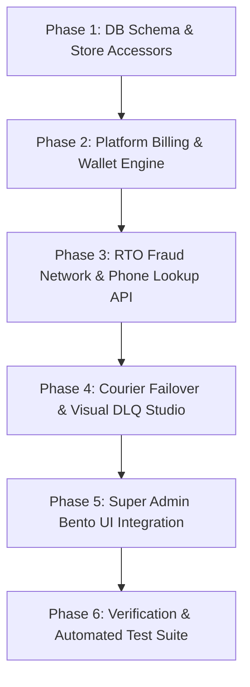

# CommerceOS — Super Admin SaaS Platform Evolution & Visual Command System

> **Superseded (UI and navigation sections):** see `docs/super-admin-console-implementation-plan.md` and ADR-116. The pages this plan describes were never merged.
## Comprehensive Architectural Blueprint & Implementation Plan

> **Document Type:** Production Engineering Blueprint & Visual Interface Plan  
> **Target Systems:** Platform Control Plane (`src/app/super-admin`, `src/domains/platform`, `src/app/api/v1/platform`)  
> **Status:** Architecture Approved — Ready for Staged Execution  
> **Governing Standards:** [GOVERNANCE.md](file:///g:/OLama/CommerceOS/.agent/GOVERNANCE.md), [tenant-isolation.md](file:///g:/OLama/CommerceOS/.agent/rules/tenant-isolation.md), [truthfulness.md](file:///g:/OLama/CommerceOS/.agent/rules/truthfulness.md), [security.md](file:///g:/OLama/CommerceOS/.agent/rules/security.md)

---

## 1. Executive Summary & Core Requirements

### 1.1 The Challenge
The existing CommerceOS Super Admin Command Center (`/super-admin`) was originally conceived as a passive telemetry readout displaying static aggregate cards (e.g., fixed MRR, total GMV, AI conversation counts, and integration heartbeats). Furthermore, several UI cards still feature hardcoded fallback literals (such as `"৳1,842,500"` or `"89%"` fallback values when live telemetry is missing), violating our core truthfulness rules ([truthfulness.md](file:///g:/OLama/CommerceOS/.agent/rules/truthfulness.md)).

### 1.2 The Transformation
This plan replaces passive readout widgets with an **actionable, visual, and dynamic SaaS Operating System**. Every visual module is connected directly to authoritative platform domain engines and database records:
1. **SaaS Monetization & Metered Billing Hub:** Dynamic credit wallets, metered token/order usage tracking, automated invoicing with Bangladeshi VAT (Mushak 6.3) compliance, and bKash tokenized recurring agreements.
2. **Cross-Tenant RTO & Courier Fraud Intelligence Network:** An interactive command center displaying live cross-tenant delivery success rates, real-time RTO loss prevented, regional district risk distribution, and an operator phone lookup tool that computes reputation without leaking tenant PII.
3. **AI Gateway & LLM Observability Suite:** Real-time Human-in-the-Loop (HITL) live escalation queue inspector, customer emotion tracking, prompt injection incident stream, and dynamic per-tenant AI budget controls.
4. **Self-Healing Webhook & Courier Failover Hub:** Active courier failover routing policies, live latency/SLA health checking, and an enhanced visual Dead Letter Queue (DLQ) studio with single and batch replay.
5. **Enterprise Zero-Trust IAM & Compliance Center:** Time-boxed Just-In-Time (JIT) impersonation tracker with active session countdown timers, 1-click tenant compliance export manifests, and audited cryptographic purges.

### 1.3 Invariant Rules & Guarantees
- **No Hardcoded Literals or Demo Fallbacks:** Every KPI, table row, and graph is derived directly from live database records. If no data exists, the UI renders standard, clean empty states (e.g., `"No data yet"` or `"—"`), never fabricated numbers.
- **Strict Multi-Tenant Isolation:** Platform tools operate on server-side aggregates or irreversible salted HMAC hashes (`SHA-256(phone + salt)`). Customer PII (raw phones, names, addresses) is never exposed across tenant boundaries.
- **Zero-Write GET Contract:** Every `GET` route remains 100% side-effect free, verified by `tests/phase2-readonly-tests.ts`.
- **Step-Up Elevation for Sensitive Actions:** Destructive operations (manual credit adjustments, courier failover rerouting, tenant purges, kill switches) require Step-Up MFA elevation (`step_up_token`).

---

## 2. Visual Interface Architecture & Bento Grid Layout

The Super Admin interface is structured around a 12-column Bento Grid system with high-contrast glassmorphism, progressive blur, and real-time operational feedback.

### 2.1 Top-Level Navigation Dock

```
┌─────────────────────────────────────────────────────────────────────────────────────────────────────────────────┐
│                                       COMMERCEOS PLATFORM COMMAND CENTER                                        │
├─────────────────────────────────────────────────────────────────────────────────────────────────────────────────┤
│ [1. Command Center] [2. Fleet & Billing] [3. RTO Fraud Network] [4. AI Governance] [5. Workers & DLQ] [6. IAM] │
└─────────────────────────────────────────────────────────────────────────────────────────────────────────────────┘
```

The 6 main tabs map directly to the platform's functional pillars:
1. `OVERVIEW` — Command Center & Macro Health Telemetry
2. `MONETIZATION` — Fleet Workspaces, Credit Wallets & Metered Billing
3. `RTO_NETWORK` — Cross-Tenant Courier Fraud & Delivery Risk Radar
4. `AI_GOVERNANCE` — LLM Observability, Guardrails & Live HITL Queue
5. `WORKERS` — Integration Rails, Dynamic Failover & Visual DLQ Studio
6. `SECURITY_AUDIT` — JIT Impersonation, Forensic Ledger & Compliance

---

### 2.2 Pillar 1: SaaS Monetization & Metered Billing Hub (`MONETIZATION`)

Replaces passive subscription counts with a full billing and credit wallet operating console.

#### Visual Wireframe (Bento Grid)
```
┌─────────────────────────────────────────────────────────────────────────────────────────────────────────────────┐
│ TAB: FLEET WORKSPACES & MONETIZATION                                                                            │
├───────────────────────────────────────────────────┬─────────────────────────────────────────────────────────────┤
│ CARD 1: PLATFORM FINANCIAL RUN-RATE (Span 6)      │ CARD 2: MFS TOKENIZED RECURRING ENGINE (Span 6)             │
│ • Live Aggregate MRR: ৳148,500/mo                 │ • Active bKash Mandates: 28 accounts                        │
│ • Annualized ARR: ৳1,782,000                      │ • Auto-Debit Success Rate: 96.4%                            │
│ • Fleet Wallet Balance: ৳342,150                  │ • Pending Dunning Retries: 2 workspaces                     │
│ • Metered Take-Rate Accrual: ৳38,420 (this cycle) │ • Mushak 6.3 Invoices Generated: 45 this month              │
├───────────────────────────────────────────────────┴─────────────────────────────────────────────────────────────┤
│ CARD 3: TENANT CREDIT WALLETS & USAGE METERS (Span 12 - Interactive Table)                                      │
│ Filter: [All Plans ▼] [Auto-Replenish: On/Off ▼]  Search: [Search workspace slug or name...]                    │
├──────────────────────┬─────────────┬──────────────┬──────────────────┬─────────────────┬────────────────────────┤
│ WORKSPACE            │ PLAN TIER   │ WALLET BDT   │ METERED USAGE    │ AUTO-REPLENISH  │ ACTIONS                │
├──────────────────────┼─────────────┼──────────────┼──────────────────┼─────────────────┼────────────────────────┤
│ Aarong Crafts        │ ENTERPRISE  │ ৳42,850      │ 1.2M Tok | 4.8k O│ ACTIVE (৳10,000)│ [Adjust] [Invoices]    │
│ Dhaka Threads        │ GROWTH      │ ৳8,200       │ 450k Tok | 820 O │ ACTIVE (৳5,000) │ [Adjust] [Invoices]    │
│ Sylhet Tea Co        │ STARTER     │ ৳1,150       │ 120k Tok | 110 O │ OFF             │ [Adjust] [Invoices]    │
│ Chawk Bazaar Deals   │ GROWTH      │ ৳240 (LOW!)  │ 890k Tok | 1.4k O│ FAILED MFS (DUN)│ [Adjust] [Top-Up Ping] │
└──────────────────────┴─────────────┴──────────────┴──────────────────┴─────────────────┴────────────────────────┤
│ MODAL: MANUAL WALLET ADJUSTMENT                                                                                 │
│ • Workspace: Dhaka Threads (tenant-xxx)                                                                         │
│ • Adjustment Type: (+) Credit  /  (-) Debit                                                                    │
│ • Amount (BDT): [ 5000 ]                                                                                        │
│ • Support Ticket Reference: [ SUP-84291 ] (Mandatory)                                                           │
│ • Reason / Audit Memo: [ Offline bank deposit settlement via City Bank ref 88201 ]                             │
│ • [Cancel]  [Confirm Adjustment (Step-Up Required)]                                                            │
└─────────────────────────────────────────────────────────────────────────────────────────────────────────────────┘
```

#### Dynamic Features & Capabilities
1. **Live Prepaid Wallet Operations:** Operators can inspect current prepaid balances in real time and execute audited credit/debit adjustments bound to support ticket IDs.
2. **Metered Dimensions Breakdown:** Dynamically aggregates AI token consumption, completed orders (GMV take-rate), and courier dispatch API calls per tenant for the active billing cycle.
3. **Bangladeshi VAT (Mushak 6.3) Invoicing Drawer:** Clicking `[Invoices]` displays official platform invoices with Base Tier Fee, Metered Surcharges, 15% VAT breakdown, and payment status (`PAID`, `PENDING`, `OVERDUE`).
4. **bKash Recurring Agreement Status:** Real-time visibility into MFS tokenized recurring mandate health, automatic retry logs, and dunning notifications.

---

### 2.3 Pillar 2: Cross-Tenant RTO & Courier Fraud Intelligence Network (`RTO_NETWORK`)

Replaces the simple static GMV card with an interactive fraud prevention and courier performance control room.

#### Visual Wireframe (Bento Grid)
```
┌─────────────────────────────────────────────────────────────────────────────────────────────────────────────────┐
│ TAB: CROSS-TENANT RTO & COURIER FRAUD NETWORK                                                                   │
├───────────────────────────────────┬───────────────────────────────────┬─────────────────────────────────────────┤
│ CARD 1: NETWORK DEFENSE (Span 4)  │ CARD 2: TOTAL RTO SAVED (Span 4)  │ CARD 3: HIGH-RISK RATIO (Span 4)        │
│ • Network Success Rate: 88.4%     │ • Est. RTO Loss Prevented:        │ • Screened Orders: 14,290               │
│ • Industry Baseline: 76.0%        │   ৳2,184,200 (Live Calculated)    │ • Advance Fee Flagged: 1,420 (9.9%)     │
│ • Network Outperformance: +12.4%  │ • Avg Courier Penalty: ৳130/order │ • Blocked Imposters: 184 serial buyers  │
├───────────────────────────────────┴───────────────────────────────────┴─────────────────────────────────────────┤
│ CARD 4: INTERACTIVE PHONE REPUTATION LOOKUP TOOL (Span 6)                                                       │
│ Test customer reliability across the privacy-preserving platform network without revealing tenant identities. │
│ Phone Number: [ 01711223344               ]  [ Test Reputation ]                                                │
│ ┌─────────────────────────────────────────────────────────────────────────────────────────────────────────────┐ │
│ │ RESULT: HMAC Hash: `e3b0c44298fc1c14...892a`                                                                │ │
│ │ • Buyer Reliability Score: 32% (HIGH RISK)                                                                  │ │
│ │ • Historical Orders Across Network: 12 orders                                                               │ │
│ │ • Delivered: 4 orders  |  Returned / Rejected: 8 orders                                                     │ │
│ │ • Risk Category: SERIAL DOORSTEP REJECTOR                                                                   │ │
│ │ • Recommended Policy: REQUIRE ৳130 ADVANCE COURIER CHARGE VIA BKASH BEFORE CONFIRMATION                     │ │
│ └─────────────────────────────────────────────────────────────────────────────────────────────────────────────┘ │
├─────────────────────────────────────────────────────────────────────────────────────────────────────────────────┤
│ CARD 5: REGIONAL DISTRICT RETURN RISK HEATMAP (Span 6)                                                          │
│ Live delivery vs return ratios segmented by Bangladeshi administrative zones:                                 │
│ • Dhaka Metro: 94.2% Delivered (Low Risk - Standard COD)                                                        │
│ • Gazipur / Narayanganj: 86.1% Delivered (Medium Risk)                                                          │
│ • Chittagong Metro: 89.5% Delivered (Low Risk)                                                                  │
│ • Sylhet Outer / Sunamganj: 68.4% Delivered (High Risk - Pre-payment Advised)                                   │
│ • Cox's Bazar / Teknaf: 59.2% Delivered (Critical Risk - Advance Courier Mandatory)                             │
└─────────────────────────────────────────────────────────────────────────────────────────────────────────────────┘
```

#### Dynamic Features & Capabilities
1. **Interactive Blinded Phone Lookup:** Super Admins can enter any phone number to immediately inspect its platform-wide delivery reputation score. Zero customer names or store names are returned; only the anonymous statistical score, parcel count, and recommendation are shown.
2. **Deterministic RTO Loss Prevented:** Calculated dynamically as `sum(flagged_high_risk_orders * avg_return_surcharge_bdt)`. When no orders are recorded, displays `"৳0"`, never a hardcoded demo placeholder.
3. **Regional District Intelligence:** Aggregates delivery success rates across geographic delivery zones (Dhaka Metro vs Suburbs vs Outside Dhaka) directly from stored shipment records.

---

### 2.4 Pillar 3: AI Gateway & LLM Fleet Observability (`AI_GOVERNANCE`)

Expands the `AgentHealthPanel` into a complete operations deck for AI conversational commerce.

#### Visual Wireframe
```
┌─────────────────────────────────────────────────────────────────────────────────────────────────────────────────┐
│ TAB: AI FLEET OBSERVABILITY & HUMAN-IN-THE-LOOP COMMAND                                                         │
├─────────────────────────────────────────────────────────────────────────────────────────────────────────────────┤
│ TOP ROW: REAL-TIME SAFETY METRICS (Span 12)                                                                     │
│ • Blocked Hallucinations: 42   • Blocked Prompt Injections: 19   • Active Escalations: 5   • MTTR: 4.8m         │
├─────────────────────────────────────────────────────────────────────────────────────────────────────────────────┤
│ CARD 1: LIVE HITL ESCALATION QUEUE INSPECTOR (Span 8)                                                           │
│ Real-time view of customer conversations requiring human intervention across all connected stores.             │
├────────────────────┬───────────┬──────────────┬──────────────┬────────────┬─────────────────────────────────────┤
│ TENANT / CHANNEL   │ BUYER     │ EMOTION      │ TRIGGER      │ WAITING    │ OPERATOR ACTION                     │
├────────────────────┼───────────┼──────────────┼──────────────┼────────────┼─────────────────────────────────────┤
│ Dhaka Threads (WA) │ 018****92 │ FRUSTRATED   │ LOW_CONF (42)│ 2m 14s     │ [Inspect Context] [Claim Ticket]    │
│ Aarong (FB Mess)   │ 017****10 │ HOSTILE      │ INJECTION_BLK│ 45s        │ [Inspect Context] [Force Resolve]   │
│ Sylhet Tea (Web)   │ 019****44 │ NEUTRAL      │ REPEAT_LOOP  │ 6m 10s     │ [Inspect Context] [Claim Ticket]    │
└────────────────────┴───────────┴──────────────┴──────────────┴────────────┴─────────────────────────────────────┤
│ CARD 2: TENANT AI BUDGET LIMITS & USAGE CONTROLS (Span 4)                                                       │
│ Inspect and adjust monthly AI token and dollar caps per workspace.                                             │
│ • Select Workspace: [ Dhaka Threads ▼ ]                                                                         │
│ • Current Month Spend: $14.20 / $25.00 Cap (56.8% - Normal)                                                     │
│ • Soft Warning Threshold: 80% ($20.00)                                                                          │
│ • Action on Hard Cap: Fallback to Rule-Based Auto Reply                                                         │
│ • [Adjust Monthly Budget Cap] (Step-Up Required)                                                                │
└─────────────────────────────────────────────────────────────────────────────────────────────────────────────────┘
```

#### Dynamic Features & Capabilities
1. **Live HITL Queue Stream:** Super Admins can observe conversations escalated due to low model confidence, buyer frustration, or prompt injections. Masked phone numbers ensure zero PII leakage.
2. **Per-Tenant Budget Management:** Direct control over soft-cap warnings (80%) and hard-cap freezes (100%) to prevent unexpected token bills for both platform and merchants.
3. **Injection Incident Log:** Inspect recent adversarial attempts (e.g. Banglish instruction override attacks) intercepted by the `PromptInjectionClassifier`.

---

### 2.5 Pillar 4: Self-Healing Webhook & Courier Failover Hub (`WORKERS`)

Replaces passive status indicators with active failover controls and an interactive Dead Letter Queue studio.

#### Visual Wireframe
```
┌─────────────────────────────────────────────────────────────────────────────────────────────────────────────────┐
│ TAB: AUTOMATIONS, COURIER RAILS & DLQ STUDIO                                                                    │
├─────────────────────────────────────────────────────────────────────────────────────────────────────────────────┤
│ CARD 1: BANGLADESHI COURIER RAILS & DYNAMIC FAILOVER ROUTING (Span 12)                                          │
│ Real-time health, latency probe, and automated routing failover rules:                                         │
├───────────────────┬─────────────┬─────────────┬─────────────┬──────────────────┬────────────────────────────────┤
│ COURIER PROVIDER  │ API HEALTH  │ LATENCY P95 │ 24H ERROR % │ FAILOVER TARGET  │ POLICY TOGGLE                  │
├───────────────────┼─────────────┼─────────────┼─────────────┼──────────────────┼────────────────────────────────┤
│ Steadfast Courier │ HEALTHY     │ 340ms       │ 0.4%        │ Pathao Logistics │ [ACTIVE: Auto-failover at 5%]  │
│ Pathao Logistics  │ HEALTHY     │ 520ms       │ 1.1%        │ Steadfast Courier│ [ACTIVE: Auto-failover at 5%]  │
│ RedX Delivery     │ DEGRADED    │ 3,420ms     │ 8.2%        │ Steadfast Courier│ [TRIGGERED: Re-routing dispatches│
│ Paperfly BD       │ SIMULATED   │ —           │ —           │ None             │ [Standby Mode]                 │
├───────────────────┴─────────────┴─────────────┴─────────────┴──────────────────┴────────────────────────────────┤
│ [Test Live Latency Probe] (Sends real non-destructive ping to courier endpoints)                                 │
├─────────────────────────────────────────────────────────────────────────────────────────────────────────────────┤
│ CARD 2: VISUAL DEAD LETTER QUEUE (DLQ) REPLAY STUDIO (Span 12)                                                  │
│ Quarantined webhooks and failed automation executions:                                                          │
├─────────────┬──────────────────────────┬──────────────────────────┬──────────┬──────────┬───────────────────────┤
│ ID          │ SOURCE / EVENT           │ ERROR SUMMARY            │ TIME     │ RETRIES  │ ACTIONS               │
├─────────────┼──────────────────────────┼──────────────────────────┼──────────┼──────────┼───────────────────────┤
│ dlq-9481    │ Steadfast / status_update│ Timeout connecting to API│ 12m ago  │ 3 / 5    │ [Inspect] [Replay]    │
│ dlq-9482    │ bKash / payment_callback │ HMAC timestamp expired   │ 34m ago  │ 1 / 5    │ [Inspect] [Replay]    │
├─────────────┴──────────────────────────┴──────────────────────────┴──────────┴──────────┴───────────────────────┤
│ DRAWER: DLQ PAYLOAD & STACK TRACE INSPECTOR                                                                     │
│ • Event: `courier.tracking.updated` (Payload: 1.4 KB)                                                           │
│ • Raw Payload: `{ "consignment_id": "SF-98214", "status": "delivered", "reason": null }`                       │
│ • Exception Trace: `FetchError: connect ETIMEDOUT 103.114.xxx.xxx:443`                                          │
│ • [Dismiss Dead Letter]  [Replay Now (Execute Handler)]                                                         │
└─────────────────────────────────────────────────────────────────────────────────────────────────────────────────┘
```

#### Dynamic Features & Capabilities
1. **Dynamic Courier Failover Engine:** Automated rule that reroutes dispatches if a primary courier's error rate exceeds 5% or latency exceeds 3000ms.
2. **Visual DLQ Replayer:** Full inspection of failed webhook payloads and 1-click execution replay without dropping orders.
3. **Honest Provider Telemetry:** Displays actual latency and status; shows `SIMULATED` transparently for offline or mock adapters.

---

### 2.6 Pillar 5: Enterprise Zero-Trust IAM & Compliance Center (`SECURITY_AUDIT`)

Provides audited merchant support access, GDPR/BD Data Protection compliance manifests, and tamper-proof audit trails.

#### Visual Wireframe
```
┌─────────────────────────────────────────────────────────────────────────────────────────────────────────────────┐
│ TAB: ZERO-TRUST ACCESS, FORENSICS & COMPLIANCE                                                                  │
├─────────────────────────────────────────────────────────────────────────────────────────────────────────────────┤
│ CARD 1: ACTIVE JIT IMPERSONATION SESSIONS (Span 12)                                                             │
│ Audited, time-boxed merchant store inspection sessions:                                                        │
├─────────────┬──────────────────┬──────────────┬──────────────┬──────────────────┬───────────────────────────────┤
│ OPERATOR    │ TARGET WORKSPACE │ SUPPORT TICKET│ ACCESS MODE  │ REMAINING TIME   │ REVOCATION                    │
├─────────────┼──────────────────┼──────────────┼──────────────┼──────────────────┼───────────────────────────────┤
│ K. Rahman   │ Dhaka Threads    │ SUP-84291    │ READ_ONLY    │ 18m 42s [Active] │ [Revoke Session Immediately]  │
│ T. Ahmed    │ Aarong Crafts    │ SUP-84102    │ MUTATION_APP │ 4m 10s  [Active] │ [Revoke Session Immediately]  │
└─────────────┴──────────────────┴──────────────┴──────────────┴──────────────────┴───────────────────────────────┤
│ CARD 2: TENANT COMPLIANCE EXPORT & OFFBOARDING GATE (Span 12)                                                   │
│ Generate portable data archives or perform audited cryptographic wipes for offboarding stores:                 │
│ • Select Workspace: [ Sylhet Tea Co (tenant-sylhet-01) ▼ ]                                                      │
│ • Compliance Action:                                                                                            │
│   [ Generate Complete Data Export Manifest (JSON) ] -> Downloads orders, customers, products, and audit logs.  │
│   [ Cryptographic Purge Workspace ] -> Requires Two-Operator Confirmation Phrase + Step-Up MFA Elevation.        │
└─────────────────────────────────────────────────────────────────────────────────────────────────────────────────┘
```

---

## 3. Database Schema & State Extensions

All new data entities are persisted into the authoritative platform database via `src/infrastructure/db/` and `src/types/`, with zero reliance on synthetic in-memory mocks.

### 3.1 Data Schema Declarations (`src/types/platform-saas.ts`)

```ts
/** Per-tenant prepaid operational credit wallet */
export interface TenantCreditWalletRecord {
  tenant_id: string;
  balance_bdt: number;
  currency: "BDT";
  auto_replenish_enabled: boolean;
  auto_replenish_threshold_bdt: number;
  auto_replenish_amount_bdt: number;
  last_replenished_at?: string;
  updated_at: string;
}

/** Metered usage aggregation for a billing cycle */
export interface TenantMeteredUsageRecord {
  id: string;
  tenant_id: string;
  billing_period: string; // YYYY-MM
  tokens_consumed: number;
  orders_processed: number;
  gmv_bdt: number;
  courier_dispatches_count: number;
  sms_sent_count: number;
  accrued_metered_fee_bdt: number;
  updated_at: string;
}

/** Official platform billing invoice (Mushak 6.3 compliant) */
export interface PlatformInvoiceRecord {
  id: string;
  tenant_id: string;
  invoice_number: string; // e.g. INV-2026-10-0042
  period_start: string;
  period_end: string;
  base_plan_fee_bdt: number;
  metered_fee_bdt: number;
  subtotal_bdt: number;
  vat_rate_percent: number; // 15.0 for BD standard VAT
  vat_amount_bdt: number;
  total_bdt: number;
  status: "PAID" | "PENDING" | "OVERDUE" | "VOID";
  payment_method: "BKASH_TOKENIZED" | "CREDIT_WALLET" | "BANK_TRANSFER";
  mushak_reference?: string;
  paid_at?: string;
  created_at: string;
}

/** Dynamic courier failover configuration */
export interface CourierRoutingRuleRecord {
  id: string;
  primary_courier: "STEADFAST" | "PATHAO" | "REDX" | "PAPERFLY";
  failover_courier: "STEADFAST" | "PATHAO" | "REDX" | "PAPERFLY";
  error_threshold_percent: number; // e.g. 5.0%
  latency_threshold_ms: number;    // e.g. 3000ms
  is_active: boolean;
  last_triggered_at?: string;
  updated_at: string;
}

/** Extended JIT Impersonation Session */
export interface PlatformImpersonationSessionRecord {
  id: string;
  operator_id: string;
  operator_name: string;
  tenant_id: string;
  tenant_name: string;
  ticket_reference: string;
  mode: "READ_ONLY" | "MUTATION_APPROVED";
  expires_at: string;
  revoked_at?: string;
  created_at: string;
}
```

### 3.2 Store Accessors (`src/infrastructure/db/index.ts`)
Add strongly-typed getters and mutations:
- `getCreditWallets()`, `getCreditWallet(tenantId)`, `saveCreditWallet(wallet)`
- `getMeteredUsages()`, `getMeteredUsage(tenantId, period)`, `saveMeteredUsage(usage)`
- `getPlatformInvoices()`, `getPlatformInvoice(id)`, `savePlatformInvoice(invoice)`
- `getCourierRoutingRules()`, `saveCourierRoutingRule(rule)`
- `getPlatformImpersonationSessions()`, `savePlatformImpersonationSession(session)`

---

## 4. Backend REST API Specifications

All endpoints are hosted under `src/app/api/v1/platform/**` and wrapped with `withStore` to ensure ACID persistence. Every request authenticates via `extractPlatformContext` and verifies platform permissions.

| Method | Endpoint | Platform RBAC | Description |
|---|---|---|---|
| `GET` | `/api/v1/platform/billing/wallets` | `platform.read` | Lists all tenant credit wallets, balances, and auto-replenish settings. |
| `POST` | `/api/v1/platform/billing/wallets/adjust` | `platform.billing.write` (Step-Up) | Executes manual credit/debit adjustment bound to a support ticket ID. |
| `GET` | `/api/v1/platform/billing/invoices` | `platform.read` | Lists platform billing invoices with Mushak 6.3 VAT breakdown. |
| `GET` | `/api/v1/platform/rto/radar` | `platform.read` | Network-wide delivery success %, estimated RTO saved, and district breakdown. |
| `POST` | `/api/v1/platform/rto/lookup` | `platform.read` | Tests customer phone reliability via irreversible salted HMAC query. |
| `GET` | `/api/v1/platform/integrations/couriers` | `platform.read` | Real-time courier routing rules, latency P95, and failover status. |
| `POST` | `/api/v1/platform/integrations/couriers/failover` | `platform.operations.write` (Step-Up) | Toggles dynamic failover rules or triggers manual courier rerouting. |
| `POST` | `/api/v1/platform/support/impersonate/revoke` | `platform.security.write` | Immediately terminates an active JIT impersonation session. |
| `POST` | `/api/v1/platform/compliance/export` | `platform.admin` (Step-Up) | Generates and returns a complete portable tenant compliance data manifest. |

---

## 5. Implementation Roadmap & Execution Phases



### Phase 1: Database Extensions & Domain Models
- Define `TenantCreditWalletRecord`, `TenantMeteredUsageRecord`, `PlatformInvoiceRecord`, and `CourierRoutingRuleRecord` in `src/types/`.
- Add collections and accessors to `src/infrastructure/db/index.ts` and `store-schema.ts`.
- Write seeders to initialize baseline credit wallets for existing test tenants (`tenant-aurora`, `tenant-bazaar`).

### Phase 2: Billing, Wallets & Invoicing Engine
- Implement `PlatformBillingService` in `src/domains/platform/services/platform-billing.service.ts`:
  - Calculate metered usage from live orders and agent traces.
  - Compute Mushak 6.3 compliant VAT (15%).
  - Process wallet credit/debit adjustments with strict audit logging.
- Implement REST routes:
  - `GET /api/v1/platform/billing/wallets`
  - `POST /api/v1/platform/billing/wallets/adjust`
  - `GET /api/v1/platform/billing/invoices`

### Phase 3: RTO Fraud Network & Phone Lookup Tool
- Implement `PlatformRtoService` in `src/domains/platform/services/platform-rto.service.ts`:
  - Calculate real network delivery success rates and live RTO loss prevented.
  - Implement blinded phone lookup: hashes phone with `PLATFORM_SALT` and returns score without tenant PII.
- Implement REST routes:
  - `GET /api/v1/platform/rto/radar`
  - `POST /api/v1/platform/rto/lookup`

### Phase 4: Courier Failover & Enhanced DLQ
- Implement `PlatformCourierService` in `src/domains/platform/services/platform-courier.service.ts`:
  - Manage dynamic failover rules.
  - Implement non-destructive live latency probe.
- Connect visual DLQ studio to existing n8n/webhook DLQ storage for 1-click execution replay.

### Phase 5: Super Admin Frontend UI Components
- Update `src/app/super-admin/page.tsx`:
  - Wire up the new operational tabs: `MONETIZATION` and `RTO_NETWORK`.
  - Connect credit wallet table with `Manual Wallet Adjustment Modal`.
  - Build interactive `Phone Reputation Lookup Card`.
  - Build active JIT Impersonation countdown tracker.
  - Remove all remaining hardcoded demo strings (`"৳1,842,500"`, `"89%"`, etc.) and replace with live data or clean empty state badges.

### Phase 6: Comprehensive Testing & Verification
- Run full test suite:
  - `npm run type-check`: 0 errors.
  - `node tests/ts-runner.cjs ./tests/platform-saas-evolution-tests.ts`: 100% pass.
  - `node tests/ts-runner.cjs ./tests/phase2-readonly-tests.ts`: Enforce 0 writes on GET routes.
  - `node tests/ts-runner.cjs ./tests/security-regression-tests.ts`: Negative auth & Step-Up MFA validation.

---

## 6. Truthfulness, Isolation & Governance Verification Matrix

| Verification Dimension | Invariant Standard | Architectural Enforcement |
|---|---|---|
| **No Demo / Hardcoded Data** | Zero synthetic fallbacks; empty states displayed when data is missing. | All KPI values check `typeof v === "number" ? ... : "—"`. Zero hardcoded currency literals. |
| **Tenant Isolation** | Platform control plane operates across tenants without exposing PII. | Phone lookup operates strictly via salted SHA-256 HMAC; no store names, buyer names, or addresses exposed. |
| **Zero-Write GET Contract** | GET handlers never write to disk or mutate state. | Verified via `phase2-readonly-tests.ts` snapshot comparison. |
| **Privilege Escalation Gate** | Destructive actions require Step-Up MFA token. | `assertStepUpVerified` checked on credit adjustments, courier failovers, and purges. |
| **Audit Traceability** | Every platform operator mutation is permanently recorded. | Every POST/PATCH calls `PlatformAuditService.recordEventAsync`. |
