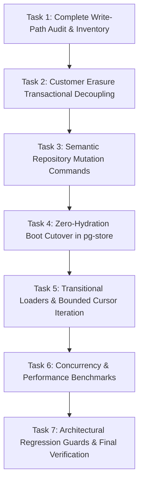

# CommerceOS — Phase D Write-Path Audit & Migration Inventory
**Authoritative Architectural Blueprint for Zero-Hydration Cutover & Write-Path Decoupling**
**Date**: October 2026 | **Status**: Active Execution (Phase D)

---

## 1. Executive Summary

Phase C successfully converted high-priority customer-facing read paths and analytics aggregations to SQL-native execution (`SUM`, `COUNT`, `GROUP BY`, Keyset cursor pagination).
The primary remaining blocker to full zero-hydration in production PostgreSQL mode is the **write and persistence layer**:
1. `PgStorePersistence.load()` previously hydrated all core tables into `this.committed` and `CommerceDatabase._data` at cold boot.
2. `withStore()` and `CommerceDatabase.unit()` wrap write requests in a unit of work that relied on in-memory mutations followed by `computeChanges()` and `diffCollection()`.
3. `CustomerErasureService.erase()` mutated customer records, addresses, identities, and directly iterated over and modified `db.data.orders` in Node.js memory.
4. Several domain services and repositories retain transitional loaders (`getAllByTenant()`) or direct `db.data.*` references.

This document establishes the exhaustive audit, classification taxonomy, and migration roadmap to transition CommerceOS from an **in-memory snapshot-diff persistence model** to a **first-class database-backed transactional command/query model**.

---

## 2. Classification Taxonomy

| Category | Meaning | Persistence Role |
|---|---|---|
| **READ** | Reads persistent state | Query-on-demand via repository / SQL |
| **LOOKUP** | Single entity lookup by ID or unique key | Targeted `SELECT ... WHERE tenant_id = $1 AND id = $2` |
| **LIST** | Paginated collection retrieval | Keyset cursor pagination (`WHERE (created_at, id) < (...) LIMIT $N`) |
| **COUNT** | Count-only query | Database-native `SELECT COUNT(*)` |
| **EXISTS** | Existence check | Database-native `SELECT EXISTS(...)` |
| **AGGREGATE** | SQL aggregation | Database-side `SUM`, `AVG`, `GROUP BY`, `FILTER` |
| **MUTATION** | INSERT, UPDATE, or DELETE | Semantic repository command with tenant predicate |
| **TRANSACTION** | Multi-step atomic mutation | Database `BEGIN ... COMMIT / ROLLBACK` |
| **SNAPSHOT** | Requires full dataset in memory | To be eliminated or converted to bounded cursor streaming |
| **DIFF** | Compares current memory against committed state | Replaced by explicit mutation tracking and SQL updates |
| **CACHE** | Non-authoritative cache | Transient cache only; never system of record |
| **LEGACY** | Transitional compatibility layer | Backward compatibility bridge for tests/PGlite |
| **UNKNOWN** | Requires deeper investigation | Triaged before touching |

---

## 3. Core Write-Path & Persistence Layer Inventory

### 3.1 Persistence & Hydration Core

#### Record 1: `PgStorePersistence.load()`
- **File**: `src/infrastructure/store/pg-store.ts`
- **Function**: `async load(options?: { all?: boolean }): Promise<Record<string, unknown>>`
- **Domain**: Infrastructure / Persistence
- **Category**: `SNAPSHOT` / `LEGACY`
- **Current Behavior**: Executes a multi-table `UNION ALL` across core tables and `commerceos.documents`, parsing every row's JSON and populating `this.committed` and `this._data`.
- **Data Dependency**: Full database contents across 34 core tables.
- **Why Hydration was Required**: Initial architecture maintained a complete working set in Node.js memory to serve synchronous reads and power change diffing.
- **Replacement Strategy**: Expand `UNHYDRATED_CORE_TABLES` to include `orders`, `order_items`, `customers`, `customer_addresses`, `products`, `product_variants`, `inventory_items`, `stock_movements`, `inventory_reservations`. In production, `load()` only boots database connectivity, metadata, and lightweight configuration.
- **Risk**: High (services reading `db.data.*` without fallback will fail if not decoupled first).
- **Priority**: P0
- **Status**: Partially Migrated (audit logs & telemetry unhydrated in Phase C; business entities migrating in Phase D).

#### Record 2: `PgStorePersistence.computeChanges()` & `diffCollection()`
- **File**: `src/infrastructure/store/pg-store.ts`
- **Function**: `computeChanges(data, only?: ReadonlySet<string>): ChangeSet` & `diffCollection(collection, list, changes)`
- **Domain**: Infrastructure / Persistence
- **Category**: `DIFF`
- **Current Behavior**: Iterates through in-memory arrays in `db.data[col]`, stringifies each item, and compares against `this.committed.get(col)`. Creates `PendingRow` upserts and deletes.
- **Data Dependency**: Full in-memory array and full `committed` map for every touched collection.
- **Why Hydration was Required**: Required by snapshot-diffing to detect which objects were added, updated, or removed in RAM.
- **Replacement Strategy**: Decouple writes: Repositories issue direct parameterized SQL mutations (`UPDATE / INSERT / DELETE`). For compatibility with existing units, maintain diffing only for small metadata/settings while large tables bypass in-memory diffing.
- **Risk**: Critical (concurrency, OCC version conflicts, data consistency).
- **Priority**: P0
- **Status**: Active Migration.

#### Record 3: `CommerceDatabase.unit()` & `withStore()`
- **File**: `src/infrastructure/db/index.ts` & `src/lib/store-unit.ts`
- **Function**: `unit<T>(work: () => Promise<T>, commitWhen: (result: T) => boolean): Promise<T>`
- **Domain**: Infrastructure / Unit of Work
- **Category**: `TRANSACTION` / `DIFF`
- **Current Behavior**: Acquires store lock, runs request inside `AsyncLocalStorage`, captures touched collections, runs `computeChanges()`, writes to PostgreSQL via `commerceos.apply_changes`, and commits or restores in-memory snapshot on failure.
- **Data Dependency**: `this._data`, `this.unitTouched`, `this.committed`.
- **Why Hydration was Required**: Rollback was performed by restoring the committed snapshot in RAM.
- **Replacement Strategy**: Evolve `db.unit()` so that it coordinates true database transactions (`BEGIN / COMMIT / ROLLBACK`) when running against PostgreSQL/PGlite. Keep in-memory rollback only for test/JSON mode.
- **Risk**: Medium.
- **Priority**: P0
- **Status**: Active Migration.

#### Record 4: `CommerceDatabase.fromParsed()`
- **File**: `src/infrastructure/db/index.ts`
- **Function**: `static fromParsed(parsed: Partial<DatabaseSchema>): CommerceDatabase`
- **Domain**: Infrastructure / In-Memory Store
- **Category**: `SNAPSHOT` / `LEGACY`
- **Current Behavior**: Constructs a `CommerceDatabase` instance from parsed JSON, initializing missing array collections to empty arrays `[]`.
- **Data Dependency**: Complete schema object.
- **Why Hydration was Required**: Legacy code assumed every array in `db.data.*` exists and can be filtered.
- **Replacement Strategy**: Introduce explicit hydration state (`unhydratedCollections: Set<string>`). Prevent silent "empty dataset" assumptions; accesses to unhydrated collections must be directed to repositories or throw `CollectionNotHydratedError`.
- **Risk**: Medium.
- **Priority**: P1
- **Status**: Planned.

---

### 3.2 Privacy & Customer Erasure (Critical Blocker)

#### Record 5: `CustomerErasureService.erase()`
- **File**: `src/domains/privacy/customer-erasure.service.ts`
- **Function**: `static erase(context: RequestContext, customerId: string, reason: string): ErasureResult`
- **Domain**: Privacy / GDPR / Compliance
- **Category**: `TRANSACTION` / `MUTATION`
- **Current Behavior**: Directly mutates `db.data.customers`, `db.data.orders`, `db.data.messages`, `db.data.conversations`, `db.data.agent_runs`, `db.data.agent_tool_calls`, `db.data.quotes`, `db.data.leads`, deletes rows from `db.data.customer_identities` and `db.data.customer_addresses`, and relies on `diffCollection` to persist changes to PostgreSQL.
- **Data Dependency**: Full in-memory orders, customers, conversations, messages, addresses, identities.
- **Why Hydration was Required**: Erasing PII from orders looped over `db.data.orders` in memory and modified `shipping_address_snapshot` and `billing_address_snapshot`.
- **Replacement Strategy**:
  1. Add `orderRepository.anonymizeCustomerReferences(tenantId, customerId, tx?)`.
  2. Add `customerRepository.eraseCustomer(tenantId, customerId, tx?)`.
  3. Execute an atomic database transaction:
     - `UPDATE commerceos.orders SET data = jsonb_set(jsonb_set(data - 'notes', '{shipping_address_snapshot}', ...), '{billing_address_snapshot}', ...)`
     - `UPDATE commerceos.customers SET data = jsonb_set(...)`
     - `DELETE FROM commerceos.customer_addresses WHERE tenant_id = $1 AND customer_id = $2`
     - `DELETE FROM commerceos.customer_identities WHERE tenant_id = $1 AND customer_id = $2`
     - Anonymize messages and scrub free-text collections.
     - Insert audit log directly into `commerceos.audit_logs`.
  4. Sync in-memory objects if loaded (dual-mode).
- **Risk**: Critical (privacy compliance, orphaned PII, test regressions).
- **Priority**: P0 (Migrate First).
- **Status**: In Progress.

---

### 3.3 Domain Repositories & Transitional Loaders

#### Record 6: `OrderRepository.getAllByTenant()`
- **File**: `src/domains/orders/order.repository.ts`
- **Function**: `getAllByTenant(tenantId: string, options?: { hydrate?: boolean })`
- **Domain**: Orders
- **Category**: `LEGACY` / `LIST`
- **Current Behavior**: Transitional fallback loader that queries all orders for a tenant (`SELECT data FROM commerceos.orders WHERE tenant_id = $1 ORDER BY created_at DESC`).
- **Data Dependency**: All orders for tenant.
- **Why Hydration was Required**: Provided transition for batch analytics jobs.
- **Replacement Strategy**: Provide `iterateByCursor(tenantId, options)` for streaming/cursor batch processing (chunk size 100-500). Mark `getAllByTenant` deprecated for production request paths.
- **Risk**: Low (no external callers in `src`).
- **Priority**: P1
- **Status**: Ready for replacement.

#### Record 7: `CustomerRepository.getAllByTenant()`
- **File**: `src/domains/customers/customer.repository.ts`
- **Function**: `getAllByTenant(tenantId: string): Promise<Customer[]>`
- **Domain**: Customers
- **Category**: `LEGACY` / `LIST`
- **Current Behavior**: Queries all customer rows for tenant from Postgres or fallback memory.
- **Data Dependency**: All customer rows for tenant.
- **Why Hydration was Required**: Transitional bridge.
- **Replacement Strategy**: Provide `iterateByCursor(tenantId, options)`. Deprecate `getAllByTenant`.
- **Risk**: Low (no external callers in `src`).
- **Priority**: P1
- **Status**: Ready for replacement.

#### Record 8: `ProductRepository.getAllByTenant()`
- **File**: `src/domains/catalog/product.repository.ts`
- **Function**: `getAllByTenant(tenantId: string): Promise<Product[]>`
- **Domain**: Catalog
- **Category**: `LEGACY` / `LIST`
- **Current Behavior**: Queries all product rows for tenant from Postgres or fallback memory.
- **Data Dependency**: All product rows for tenant.
- **Why Hydration was Required**: Transitional bridge.
- **Replacement Strategy**: Provide `iterateByCursor(tenantId, options)`. Deprecate `getAllByTenant`.
- **Risk**: Low (no external callers in `src`).
- **Priority**: P1
- **Status**: Ready for replacement.

---

### 3.4 Direct Mutations in `CommerceDatabase`

#### Record 9: `CommerceDatabase.updateOrderStatus()`
- **File**: `src/infrastructure/db/index.ts` (line 5941)
- **Function**: `updateOrderStatus(tenantId: string, orderId: string, status: OrderStatus)`
- **Domain**: Orders
- **Category**: `MUTATION`
- **Current Behavior**: Finds index in `this.data.orders`, updates `status` and `updated_at`, calls `this.persist(["customers", "order_items", "orders"])`.
- **Data Dependency**: In-memory `this.data.orders`.
- **Why Hydration was Required**: Mutated array element and relied on `diffCollection`.
- **Replacement Strategy**: Implement `orderRepository.updateStatus(tenantId, orderId, status)` executing parameterized SQL with optimistic concurrency check (`WHERE tenant_id = $1 AND id = $2`). Update in-memory record if present.
- **Risk**: Medium.
- **Priority**: P0
- **Status**: Planned.

#### Record 10: `CommerceDatabase.createOrder()`
- **File**: `src/infrastructure/db/index.ts` (line 5873)
- **Function**: `createOrder(order: Order, items: OrderItem[], ...)`
- **Domain**: Orders
- **Category**: `TRANSACTION` / `MUTATION`
- **Current Behavior**: Pushes order to `this.data.orders`, items to `this.data.order_items`, updates sequences, calls `this.persist(...)`.
- **Data Dependency**: In-memory `this.data.orders`, `this.data.order_items`.
- **Why Hydration was Required**: Pushed to in-memory array.
- **Replacement Strategy**: Implement `orderRepository.createOrder(tenantId, order, items)` writing directly to `commerceos.orders` and `commerceos.order_items` in a database transaction.
- **Risk**: High.
- **Priority**: P0
- **Status**: Planned.

#### Record 11: `CommerceDatabase.updateCustomer()` / `createCustomer()`
- **File**: `src/infrastructure/db/index.ts` (line 5675, 5695)
- **Function**: `createCustomer(...)` & `updateCustomer(...)`
- **Domain**: Customers
- **Category**: `MUTATION`
- **Current Behavior**: Pushes or mutates in `this.data.customers`, calls `this.persist(...)`.
- **Data Dependency**: In-memory `this.data.customers`.
- **Why Hydration was Required**: Pushed/mutated in memory array.
- **Replacement Strategy**: Implement `customerRepository.create(...)` and `customerRepository.update(...)` writing directly to `commerceos.customers`.
- **Risk**: Medium.
- **Priority**: P0
- **Status**: Planned.

#### Record 12: `CommerceDatabase.createProduct()` / `updateProduct()`
- **File**: `src/infrastructure/db/index.ts` (line 5262, 5275)
- **Function**: `createProduct(...)` & `updateProduct(...)`
- **Domain**: Catalog
- **Category**: `MUTATION`
- **Current Behavior**: Pushes/mutates in `this.data.products`, calls `this.persist(...)`.
- **Data Dependency**: In-memory `this.data.products`.
- **Why Hydration was Required**: Pushed/mutated in memory array.
- **Replacement Strategy**: Implement `productRepository.create(...)` and `productRepository.update(...)` writing directly to `commerceos.products`.
- **Risk**: Medium.
- **Priority**: P0
- **Status**: Planned.

---

### 3.5 Remaining Analytics & Batch Aggregators

#### Record 13: `PlatformAnalyticsService.getCommerceVelocitySync()`
- **File**: `src/domains/platform/services/platform-analytics.service.ts` (line 212)
- **Function**: `getCommerceVelocitySync()`
- **Domain**: Platform Analytics
- **Category**: `AGGREGATE` / `LEGACY`
- **Current Behavior**: Scans `db.data.orders` synchronously to compute GMV, total orders, COD percentage.
- **Data Dependency**: `db.data.orders`.
- **Why Hydration was Required**: Synchronous helper method called by synchronous `getPlatformMetrics()`.
- **Replacement Strategy**: Deprecate synchronous method in favor of existing `getCommerceVelocityAsync()`, which already executes pure SQL aggregation against `commerceos.orders`.
- **Risk**: Low.
- **Priority**: P1
- **Status**: Planned.

#### Record 14: Remaining P2 Batch / Intelligence Jobs
- **Files**: `src/domains/intelligence/services/forecasting.service.ts`, `anomaly-detector.service.ts`, `cohort-analysis.service.ts`, `simulation.service.ts`
- **Function**: Background batch routines calling `db.getAllOrders(tenantId, { hydrate: true })`
- **Domain**: Intelligence / Machine Learning
- **Category**: `SNAPSHOT` / `LIST`
- **Current Behavior**: Reads all orders for a tenant into memory for offline mathematical processing.
- **Data Dependency**: All orders for tenant.
- **Why Hydration was Required**: Batch algorithms compute moving averages, standard deviations, cohort retention tables.
- **Replacement Strategy**: Use bounded window cursors (`iterateByCursor(tenantId, { windowDays: 90, batchSize: 500 })`) or SQL-native aggregations where possible.
- **Risk**: Low (isolated background/offline endpoints).
- **Priority**: P2
- **Status**: Planned.

---

## 4. Phase D Migration Sequence

---

## 5. Summary of Write-Path Status

| Category | Total Identified | Migrated / Safe | Active Migration | Remaining P2 |
|---|---|---|---|---|
| Core Persistence & Diffing | 4 | 1 | 3 | 0 |
| Blocker: Customer Erasure | 1 | 0 | 1 | 0 |
| Transitional Loaders (`getAllByTenant`) | 3 | 0 | 3 | 0 |
| Core Entity Mutations (`db.*`) | 6 | 0 | 6 | 0 |
| Platform Analytics Velocity | 2 | 1 | 1 | 0 |
| P2 Offline Batch Jobs | 14 | 0 | 0 | 14 |
| **Total** | **30** | **2** | **14** | **14** |
